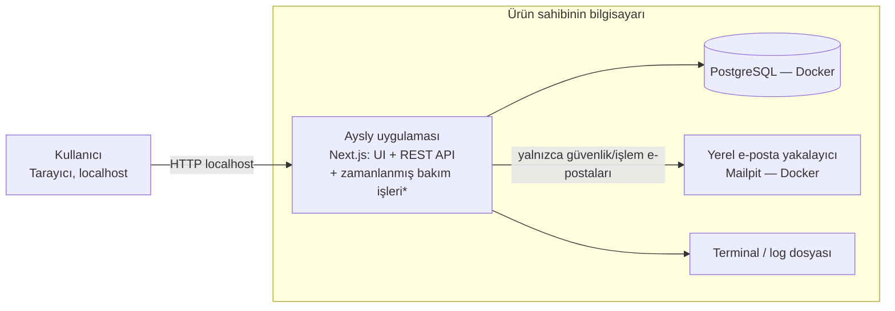
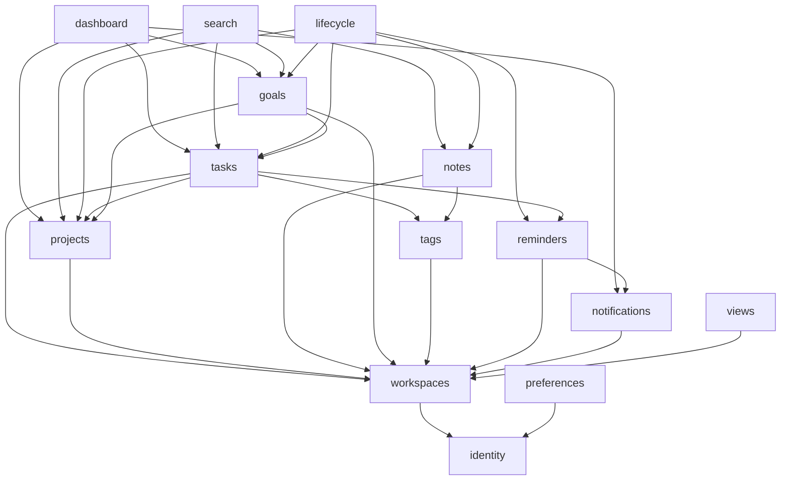
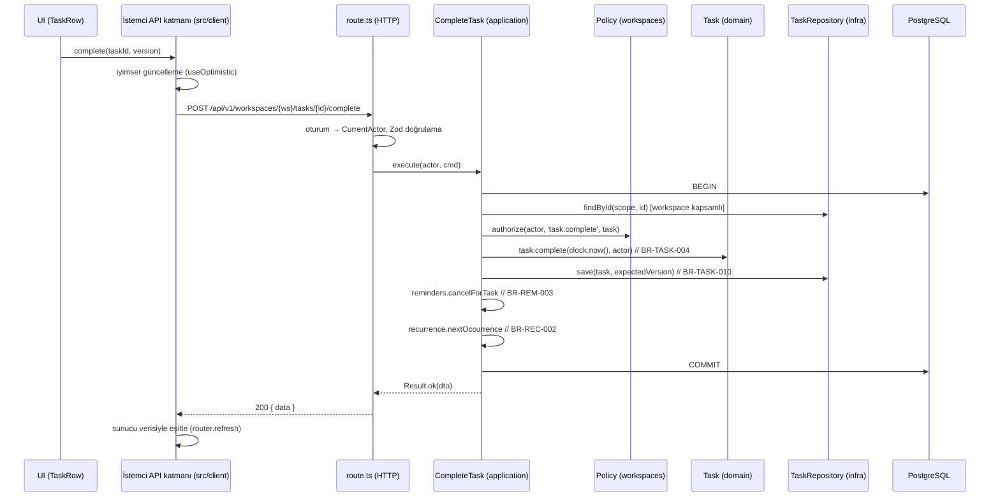

# Sistem Mimarisi

> Durum: v0.4 · Son güncelleme: 2026-10-28 · Uygulama durumu: Modüler monolit iskeleti, kimlik, çalışma alanı, projeler (Inbox), tercihler ve denetim modülleri kuruldu (Faz 2–3). Bu belge hedef mimariyi tanımlar; henüz kurulmayan modüller ilgili fazlarda gelir.
> Temel yığın **ONAYLI** (D-044), çalışma ortamı yalnızca yerel (D-045). Zamanlanmış işler D-053, Docker ile yerel PostgreSQL D-056, yerel Git + `pnpm verify` D-057, yardımcı kütüphaneler yalnızca gerektiğinde D-058. Teknik öneriler D-060 ile onaylı; D-061 sadeleştirmeleri geçerli.

## 1. Mimari hedefler

| Hedef | Mimari karşılığı |
|---|---|
| İş kuralları tek yerde ve tutarlı | Domain katmanı; kurallar kimlikleriyle kodda ve testte izlenir |
| Güvenli veri izolasyonu | Zorunlu çalışma alanı kapsamı (`WorkspaceScope`), sunucu tarafı yetkilendirme |
| Basit kurulum, sıfır işletme maliyeti | Modüler monolit + PostgreSQL, yalnızca yerel ortam, ücretli servis yok (D-010, D-045) |
| İleride yayına alınabilmek | Dış servisler arayüz (port) arkasında; ortama özgü ayarlar yapılandırmada (§12) |
| Ekip özelliklerine hazır olmak | Çalışma alanı/üyelik/rol modeli baştan var (D-012, D-014) |
| Mobil/harici istemcilere hazır olmak | Sürümlü REST API tek sözleşme yüzeyi (D-013) |
| Test edilebilirlik | Saf domain, arayüzlerle soyutlanmış altyapı (portlar) |

## 2. Sistem bağlamı

Yerel ortam (D-045):



* Zamanlanmış işler ayrı bir süreç olmadan uygulamanın içinde çalışır (D-053, §10).

- **Uygulama:** Arayüzü sunar (React Server Components + istemci bileşenleri) ve `/api/v1` REST uç noktalarını barındırır.
- **PostgreSQL:** Tek veri kaynağı. Docker Desktop üzerinde Docker Compose ile çalışır (D-056). Port **5433** (bu bilgisayarda 5432 başka bir yerel PostgreSQL kurulumunca kullanılıyor); yalnızca 127.0.0.1'e açık.
- **E-posta:** Dışarıya gerçek e-posta gönderilmez (D-037, D-045). `EmailSender` arayüzünün yerel uygulaması, e-postaları Docker üzerinde çalışan Mailpit'e gönderir; tarayıcıdan görüntülenir (D-055, D-056).
- **Yayına alındığında (OQ-032):** Aynı bileşenler; e-posta sağlayıcısı, hata izleme ve harici zamanlayıcı arayüzlerin arkasına takılır. Kod değişmez, yalnızca yapılandırma ve adaptörler eklenir.

## 3. Teknoloji seçimi (D-044)

| Teknoloji | Durum |
|---|---|
| Next.js, TypeScript, PostgreSQL, Drizzle ORM, Better Auth | ONAYLI — kullanılacak |
| Zod, Tailwind CSS, Radix UI, Vitest, Playwright | ONAYLI — uygun yerlerde kullanılabilir |
| TanStack Query | ONAYLI — **yalnızca gerekirse**; ihtiyaç gerekçesiyle önerilir, onayla eklenir (§3.7) |
| pg-boss | REDDEDİLDİ (şimdilik) — yerine D-053 |
| Yardımcı kütüphaneler (§3.9) | ONAYLI — yalnızca gerçekten ihtiyaç duyulduğunda eklenir (D-058) |

Her seçim için: neden, çözdüğü problem, alternatifler, dezavantajlar.

### 3.1. TypeScript (strict)
- **Neden:** Uçtan uca tek dil; domain modelinin tip güvenliği; API ve veri modeli arasında tip paylaşımı.
- **Alternatifler:** Ayrı backend dili (Go, Kotlin, C#) — iki dil, iki ekosistem, tip paylaşımı yok.
- **Dezavantaj:** Çalışma zamanında tip yok → tüm sınırlarda Zod ile doğrulama zorunlu.

### 3.2. Next.js (App Router) — web çatısı
- **Neden:** Tek projede SSR/RSC arayüz + API route handlers; olgun ekosistem; Claude ile geliştirmede yaygın bilgi tabanı.
- **Çözdüğü problem:** Ayrı frontend ve backend projeleri, iki dağıtım, CORS ve oturum karmaşıklığı olmadan başlamak.
- **Alternatifler:** (a) React SPA (Vite) + ayrı API (Fastify/NestJS): daha net katman ayrımı ama iki dağıtım; (b) Remix/React Router v7: benzer, ekosistemi daha küçük; (c) SvelteKit: daha az ekosistem.
- **Dezavantaj:** Çatıya bağımlılık; önbellekleme davranışları karmaşık; iş mantığının sayfa/bileşen içine sızma riski → **Kural:** `app/` klasörü yalnızca sunum ve HTTP adaptörüdür; iş mantığı `modules/` içindedir (§5). Gerekirse API ileride ayrı bir Node sunucusuna taşınabilir çünkü route handler'lar ince adaptördür.

### 3.3. PostgreSQL 16+
- **Neden:** İlişkisel veri (görev-proje-hedef-not ilişkileri), güçlü kısıtlar (CHECK, kısmi UNIQUE, bileşik FK), tam metin arama, `timestamptz`, JSONB, ileride Row Level Security.
- **Alternatifler:** MySQL (kısmi indeks ve CHECK desteği daha zayıf), MongoDB (ilişkisel bütünlük yok), SQLite (çok kullanıcılı sunucu için sınırlı).
- **Dezavantaj:** Yönetilen hizmet maliyeti; şema değişiklikleri migration disiplini gerektirir.

### 3.4. Drizzle ORM + drizzle-kit
- **Neden:** SQL'e yakın, şeffaf sorgular; TypeScript şema tanımı; kısmi indeks, CHECK, bileşik FK gibi gelişmiş kısıtlar; SQL dosyası üreten migration'lar (incelenebilir).
- **Alternatif:** Prisma — daha olgun araçlar ve iyi DX; ancak kısmi indeks/CHECK gibi kısıtlar için ham SQL migration gerekir, ağır istemci, karmaşık sorgularda esneklik azalır. Kysely — çok iyi sorgu oluşturucu, şema/migration araçları daha zayıf.
- **Dezavantaj:** Prisma'ya göre daha genç; bazı ilişki sorguları elle yazılır. Bu kabul edilebilir çünkü veri erişimi repository'lerde toplanır.

### 3.5. Better Auth — kimlik doğrulama
- **Neden:** Kendi veritabanımızda oturum ve kullanıcı tabloları (veri bize ait); e-posta/şifre, doğrulama, sıfırlama, oturum listesi hazır; ileride OAuth (Google vb.), passkey, 2FA eklentileri (D-039: MVP'de yalnızca e-posta + şifre).
- **Alternatifler:** Auth.js (credentials akışı zayıf ve sınırlı desteklenir), Lucia (bakım modu — kütüphane yerine öğretici kaynağa dönüştü), Clerk/Auth0 (yönetilen; maliyet, veri dışarıda, satıcı bağımlılığı), kendi yazdığımız auth (güvenlik riski).
- **Dezavantaj:** Kütüphane güncellemelerini takip etmek gerekir. **Önlem:** Auth kütüphanesi `modules/identity/infrastructure` arkasında; uygulama yalnızca `SessionService` ve `CurrentActor` arayüzlerini görür.

### 3.6. Zod — doğrulama
- **Neden:** API giriş/çıkış şemaları, ortam değişkenleri, form doğrulama için tek kaynak; şemadan TS tipi türetilir. İstemci ve sunucu aynı şemayı kullanır (sunucu her zaman yeniden doğrular).

### 3.7. İstemci veri yönetimi — başlangıçta TanStack Query olmadan
- **Karar (D-044):** TanStack Query yalnızca gerekirse eklenir.
- **Başlangıç yaklaşımı:** Sayfa verisi Server Components ile sunucuda okunur (application sorgu servisleri). Veri değişiklikleri `src/client/api.ts` içindeki ince, tipli bir `fetch` istemcisiyle REST API'ye gönderilir. Anlık his (NFR-02) için React'in yerleşik `useOptimistic` ve `useTransition` araçları kullanılır; işlem sonrası `router.refresh()` ile sunucu verisi tazelenir.
- **TanStack Query'nin gerekli sayılacağı durumlar** (gözlemlenirse Faz 4–5'te gerekçeyle önerilir): aynı verinin birden çok ekranda istemci tarafında anlık eşitlenmesi (BR-VIEW-002) `router.refresh()` ile yavaş kalırsa; bildirim sayacı gibi periyodik yoklamaların ve yeniden denemelerin elle yönetimi karmaşıklaşırsa; iyimser güncellemelerin geri alınması bileşenlerde tekrarlanan koda dönüşürse.
- **Mimari koruma:** Tüm istemci veri erişimi `src/client/` içinde toplanır; böylece TanStack Query sonradan eklenirse yalnızca bu katman değişir, bileşenler değişmez.

### 3.8. Tailwind CSS + Radix UI primitives
- **Neden:** Tasarım token'larının tek yerde tanımlanması (CSS değişkenleri); Radix ile erişilebilir modal, popover, menü, combobox. Bileşenler projede sahiplenilir (kopyalanmış, düzenlenebilir — shadcn/ui yaklaşımı), dış tema kütüphanesine bağımlılık yok.
- **Alternatifler:** MUI/Chakra (hazır görünüm, kendi kimliğimizi kurmayı zorlaştırır), CSS Modules (token disiplini elle).

### 3.9. Yardımcı kütüphaneler (ONAYLI, D-058 — yalnızca ihtiyaç duyulduğunda eklenir)

Bu tablodaki paketler onaylıdır ama **baştan kurulmaz**. Her paket, onu gerektiren özellik geliştirilirken eklenir ve raporda gerekçesi belirtilir. Listede olmayan paketler CODING_STANDARDS §9 ve onay sürecine tabidir.

| İhtiyaç | Önerilen | Not |
|---|---|---|
| Tarih/saat dilimi | Yerleşik `Intl` API (Faz 4, D-076; `date-fns` gerekmedi) | Yerel saat ↔ mutlak an dönüşümü ve yaz saati kuralları `modules/tasks/domain/due.ts` içinde, testli (BR-DATE-001/006); domain'de `new Date()` ile şimdiki zaman alınmaz (Clock) |
| Tekrar kuralları | `rrule`, `modules/tasks/domain/recurrence` arkasında | Saf fonksiyonla sarılır, kendi testleri |
| Sıralama anahtarı | `fractional-indexing` | BR-TASK-006 |
| i18n | `next-intl` | D-038 |
| Markdown | `remark`/`rehype` + `rehype-sanitize`; editör paketi Faz 7'de seçilir | XSS: SECURITY §5; D-042 |
| Sürükle-bırak | `@dnd-kit` | Klavye erişilebilir; D-047 |
| E-posta | Kendi `EmailSender` arayüzümüz; yerelde Mailpit/terminal adaptörü | Ücretli servis yok (D-037, D-045) |
| Loglama | `pino` | JSON log |
| Mimari denetim | `dependency-cruiser` | CODING_STANDARDS §11 |
| Test | Vitest, Testing Library, Playwright (ONAYLI); `testcontainers` (Docker, D-056), `@axe-core/playwright`, `fast-check` | TESTING_STRATEGY |
| Paket yöneticisi | pnpm | Kilit dosyası zorunlu |
| ~~Arka plan işleri: pg-boss~~ | Reddedildi (D-044) | Yerine D-053 |
| ~~Hata izleme: Sentry~~ | Çıkarıldı (barındırılan servis, D-045) | Yayın kararında yeniden değerlendirilir (OQ-032) |


### 3.10. Faz 2'de kurulan sürümler ve teknik notlar
| Paket | Sürüm | Not |
|---|---|---|
| Next.js / React | 16.4 / 19.3 | App Router, `typedRoutes` |
| TypeScript | 6.0 | 7.x (yeni yerel derleyici) çıktı, ancak typescript-eslint henüz desteklemiyor; 6.0 seçildi |
| Drizzle ORM / drizzle-kit | 0.45 / 0.31 | Sürücü: `postgres` (postgres.js) |
| Zod | 4.6 | |
| next-intl | 4.14 | URL'de dil öneki yok; dil çerezden veya tarayıcı dilinden |
| Tailwind CSS | 4.3 | Yardımcı sınıflar yalnızca Figma token'larına bağlı (`src/ui/tokens.css`, `src/app/globals.css`) |
| pino, nodemailer | 10.4, 10.2 | Log ve Mailpit SMTP |
| Vitest, Playwright, Testcontainers, axe-core, dependency-cruiser | 5.0, 1.64, 12.2, 4.14, 18.7 | Test ve mimari denetim |

- Better Auth Faz 3'te eklenecek (D-058: yalnızca gerektiğinde).
- pnpm kurulum betikleri varsayılan olarak kapalı; yalnızca `esbuild` ve `unrs-resolver` izinli (SECURITY §10).
- Bilinen uyarı: drizzle-kit'in eski bir alt bağımlılığı olan esbuild ≤0.24.2'de orta düzey bir açık var (GHSA-67mh-4wv8-2f99). Açık, esbuild'in geliştirme sunucusunu etkiliyor; bu projede o sunucu kullanılmıyor ve paket yalnızca geliştirmede çalışıyor. drizzle-kit güncellendiğinde yeniden kontrol edilecek.
## 4. Mimari stil: Modüler monolit

Kod iş alanlarına (bounded context benzeri) göre **modüllere**, her modül **katmanlara** ayrılır.

### 4.1. Modüller

| Modül | Sorumluluk | Sahip olduğu tablolar |
|---|---|---|
| `identity` | Kayıt, giriş, oturum, şifre, e-posta doğrulama, hesap silme | `users`, `auth_*` |
| `workspaces` | Çalışma alanları, üyelikler, roller, yetkilendirme politikası | `workspaces`, `workspace_memberships` |
| `preferences` | Kullanıcı tercihleri, onboarding durumu, dashboard düzeni | `user_preferences` |
| `projects` | Projeler, Inbox projesi | `projects` |
| `tasks` | Görevler, alt görevler, tekrar, sıralama, toplu işlemler | `tasks` |
| `tags` | Etiketler ve bağlantıları | `tags`, `task_tags`, `note_tags` |
| `reminders` | Hatırlatıcılar ve zamanlama | `reminders` |
| `notes` | Notlar ve bağlantıları | `notes`, `note_task_links`, `note_project_links` |
| `goals` | Hedefler, ilerleme | `goals`, `goal_task_links`, `goal_project_links` |
| `notifications` | Uygulama içi bildirim oluşturma ve tercihler (e-posta teslimi SONRA, D-037) | `notifications` (`notification_deliveries` SONRA) |
| `search` | Çapraz modül arama (okuma modeli) | — (diğer tabloların indeksleri) |
| `views` | Kayıtlı görünümler, ortak `TaskFilter` | `saved_views` |
| `lifecycle` | Arşiv/çöp/geri yükleme orkestrasyonu, temizlik işleri | — (diğer modüllerin portları) |
| `dashboard` | Dashboard okuma modeli (diğer modüllerin sorgu servislerini birleştirir) | — |
| `audit` | Güvenlik ve yıkıcı işlem olayları | `audit_events` |
| `data-portability` | JSON dışa aktarma (Faz 8, D-046) | — (diğer modüllerin okuma servislerini kullanır) |

### 4.2. Modüller arası iletişim kuralları
1. Bir modül başka bir modülün **tablolarına doğrudan erişmez**; o modülün `index.ts` ile dışa açtığı **application servisini veya sorgu arayüzünü** çağırır.
2. Okuma ağırlıklı birleşik ekranlar (dashboard, arama, My Tasks) için ayrı **okuma modelleri** (query services) yazılabilir; bunlar birden çok tabloyu okuyabilir ama **asla yazmaz**.
3. Bir işlemin birden fazla modülü etkilediği durumlar (ör. görev tamamlama → hatırlatıcı iptali → sonraki tekrar örneği) **tek veritabanı işlemi** içinde, use case tarafından orkestre edilir. İşlem dışı yan etkiler (ör. güvenlik e-postası) yalnızca işlem başarıyla tamamlandıktan sonra tetiklenir. E-posta bildirimleri eklendiğinde (SONRA) işlem içi outbox deseni kullanılır.
4. Döngüsel modül bağımlılığı yasaktır; `dependency-cruiser` (veya eşdeğeri) ile `pnpm verify` içinde denetlenir.

### 4.3. Modül bağımlılık yönü



> `goals → tasks` bağımlılığı yalnızca okuma (ilerleme hesabı) içindir. `tasks` hiçbir zaman `goals`'a bağımlı olmaz; hedef bağlantısı görev detayında `goals` modülünün sorgusuyla gösterilir.

## 5. Katmanlar ve klasör yapısı

### 5.1. Katmanların sorumlulukları

| Katman | Klasör | Sorumluluk | Bağımlı olabilir | Bağımlı olamaz |
|---|---|---|---|---|
| **Domain** | `modules/<m>/domain` | Varlıklar, değer nesneleri, iş kuralları (saf fonksiyonlar), domain hataları | `shared/kernel` | Veritabanı, HTTP, çatı, ORM, `Date.now()` (saat `Clock` portundan gelir) |
| **Application** | `modules/<m>/application` | Use case'ler (komutlar/sorgular), işlem sınırı, yetkilendirme çağrısı, portlar (arayüzler) | Domain, portlar | Somut altyapı (Drizzle, e-posta SDK'sı) |
| **Infrastructure** | `modules/<m>/infrastructure` | Repository uygulamaları (Drizzle), harici servis adaptörleri | Application portları, Drizzle | UI |
| **HTTP / API** | `modules/<m>/http` + `app/api/v1/**/route.ts` | İstek doğrulama (Zod), aktör çözümleme, use case çağırma, hata→HTTP eşlemesi | Application | Domain'i doğrudan değiştirmek, veritabanı |
| **UI** | `app/(app)/**`, `ui/` | Ekranlar, bileşenler, istemci durumu, API istemcisi | API istemcisi, paylaşılan Zod şemaları, tasarım sistemi | Repository, veritabanı, iş kuralı uygulaması |

### 5.2. Klasör yapısı (hedef)

```text
aysly/
├─ CLAUDE.md
├─ README.md
├─ docs/
├─ src/
│  ├─ app/                         # Next.js: yalnızca yönlendirme, sayfa, HTTP adaptörü
│  │  ├─ (auth)/                   # giriş, kayıt, şifre sıfırlama sayfaları
│  │  ├─ (app)/                    # oturum gerektiren uygulama sayfaları
│  │  │  ├─ dashboard/ inbox/ my-tasks/ projects/[projectId]/ calendar/
│  │  │  ├─ goals/ notes/ archive/ trash/ settings/ notifications/
│  │  └─ api/v1/                   # route.ts dosyaları → modules/*/http
│  ├─ modules/
│  │  └─ tasks/
│  │     ├─ domain/                # task.ts, task-title.ts, due-date.ts, recurrence/, errors.ts
│  │     ├─ application/           # commands/create-task.ts, queries/list-tasks.ts, ports.ts
│  │     ├─ infrastructure/        # drizzle-task-repository.ts, schema.ts
│  │     ├─ http/                  # handlers.ts, dto.ts (Zod şemaları)
│  │     └─ index.ts               # modülün dışa açık yüzü
│  ├─ shared/
│  │  ├─ kernel/                   # Result, DomainError, ID üretimi, Clock arayüzü
│  │  ├─ time/                     # saat dilimi ve tarih yardımcıları (tek kaynak)
│  │  ├─ db/                       # Drizzle istemcisi, transaction yardımcıları, WorkspaceScope
│  │  ├─ http/                     # hata eşleme, istek bağlamı, idempotency, hız sınırı (yalnızca kimlik doğrulama uç noktaları, D-061)
│  │  ├─ auth/                     # CurrentActor çözümleme (identity modülü üzerinden)
│  │  ├─ config/                   # Zod ile doğrulanan ortam değişkenleri
│  │  ├─ observability/            # logger (pino, hassas alan maskeleme)
│  │  ├─ jobs/                     # Scheduler portu, uygulama içi zamanlayıcı, PostgreSQL advisory lock (D-053)
│  │  ├─ email/                    # EmailSender portu, Mailpit SMTP ve bellek içi adaptörler (D-055)
│  │  └─ composition.ts            # bağımlılıkların elle bağlandığı tek yer
│  ├─ ui/                          # tasarım sistemi bileşenleri, token'lar
│  ├─ client/                      # tipli API istemcisi, iyimser güncelleme yardımcıları
│  ├─ i18n/                        # çeviri dosyaları (tr.json, en.json)
│  └─ instrumentation.ts           # sunucu açılışında zamanlayıcıyı başlatır (D-053)
├─ drizzle/                        # üretilmiş SQL migration dosyaları
├─ tests/
│  ├─ e2e/                         # Playwright
│  ├─ integration/                 # Testcontainers ile gerçek PostgreSQL
│  └─ fixtures/                    # test verisi üreticileri
└─ .github/workflows/
```

Birim testleri kaynak dosyanın yanında (`*.test.ts`) durur.

### 5.3. Bir isteğin yolculuğu (örnek: görev tamamlama)



## 6. Veri erişimi ve izolasyon

1. **Repository deseni:** Her modülün yazma modeli için bir repository arayüzü (application/ports) ve Drizzle uygulaması (infrastructure). Arayüz yalnızca use case'lerin ihtiyaç duyduğu metotları içerir (ISP).
2. **Zorunlu kapsam:** Çalışma alanına ait tabloları sorgulayan her repository metodu ilk parametre olarak `WorkspaceScope` alır; `WorkspaceScope` yalnızca yetkilendirme sonrasında üretilebilir (yapıcısı modül dışına kapalı). Böylece "kapsamsız sorgu" derleme zamanında zorlaşır.
3. **Transaction:** Use case başına bir işlem; `UnitOfWork` / `withTransaction(fn)` yardımcı fonksiyonu; repository'ler işlem bağlamını parametre olarak alır.
4. **Ham SQL:** Yalnızca Drizzle'ın `sql` şablonuyla (parametreli). String birleştirme ile SQL yasak.
5. **Row Level Security (RLS):** MVP'de uygulanmaz (D-060); izolasyon uygulama katmanında + kapsamlı testlerle sağlanır. Faz 10'da (paylaşılan alanlar) ek savunma katmanı olarak değerlendirilir.
6. **Okuma modelleri:** Dashboard, My Tasks, arama gibi birleşik sorgular `queries/` altında; yine `WorkspaceScope` zorunludur.

## 7. İş kurallarının yeri

| Kural türü | Yer | Örnek |
|---|---|---|
| Tek varlığın değişmezleri (invariant) | Domain varlık/değer nesnesi | `TaskTitle`, `task.complete()` |
| Birden fazla varlığı ilgilendiren kurallar | Domain servisi (saf) | `nextOccurrence(rule, from)`; `goalProgress(links)` |
| Yetki ve kapsam | Application (policy çağrısı) | `authorize(actor, 'project.delete', project)` |
| Bütünlüğün son savunması | Veritabanı kısıtı | CHECK, UNIQUE, FK |
| Kullanıcı geri bildirimi | UI (aynı Zod şeması) | Form anlık hata mesajı |

UI'daki doğrulama yalnızca deneyim içindir; sunucuda **her zaman** yeniden yapılır.

## 8. Hata yönetimi

1. **Domain/application:** Beklenen hatalar istisna fırlatmaz; `Result<T, DomainError>` döner. `DomainError` türleri: `ValidationError`, `NotFoundError`, `ForbiddenError`, `ConflictError` (sürüm), `BusinessRuleViolation(ruleId)`.
2. **Beklenmeyen hatalar** (veritabanı bağlantısı vb.) istisna olarak yükselir; HTTP katmanındaki merkezi hata işleyici `500 INTERNAL_ERROR` döner, ayrıntıyı loglar (yayına alındığında ayrıca hata izlemeye gönderir); kullanıcıya iç ayrıntı gösterilmez.
3. **HTTP eşlemesi** tek bir dosyada (`shared/http/error-mapper.ts`) tanımlanır; format API_CONTRACTS §2.4.
4. **UI:** Hata kodları çeviri anahtarlarına eşlenir; kullanıcı mesajları [ERROR_HANDLING_AND_EDGE_CASES.md](ERROR_HANDLING_AND_EDGE_CASES.md) içinde.

## 9. Kimlik doğrulama akışı (özet)
- Better Auth, `/api/auth/*` altında kendi uç noktalarını sunar; uygulama bunları `identity` modülünün HTTP adaptörü üzerinden kullanır (sözleşme API_CONTRACTS §3).
- Her API isteğinde `getCurrentActor(request)` → `{ userId, sessionId }` ya da 401.
- Çalışma alanı bağlamı URL'den (`/workspaces/{workspaceId}/...`) gelir; üyelik + rol her istekte okunur (BR-PERM-003).
- Ayrıntılar: [SECURITY.md](SECURITY.md) §4.

## 10. Zamanlanmış ve arka plan işleri (ONAYLI — D-053)

pg-boss kullanılmaz (D-044). Aşağıdaki işler **use case** olarak yazılır ve bir `Scheduler` arayüzü üzerinden tetiklenir. Böylece tetikleme yöntemi değişse de iş mantığı değişmez. Ayrı worker yoktur. Hatırlatıcılar yalnızca uygulama açıkken, silme kontrolleri yalnızca uygulama çalışırken işlenir; uygulama kapalıyken arka plan işi çalışmaz (D-053).

| İş | Tetikleyici (D-053) | Kural | Güvenlik önlemi |
|---|---|---|---|
| `reminders.materializeDue` | İstek anında: kullanıcının bildirim sayacı/listesi sorgulanırken (istemci ~60 sn'de bir yoklar) | BR-REM-005 | Koşullu güncelleme + `dedupe_key` → tek bildirim |
| `trash.purgeExpired` | Uygulama içinde periyodik (saatte bir) + uygulama açılışında | BR-DEL-003 | Idempotent; PostgreSQL advisory lock ile aynı anda tek çalışma |
| `accounts.purgeDeleted` | Aynı | BR-ACC-005 | Idempotent; her adım loglanır |
| `notifications.cleanup` | Aynı (günde bir) | BR-NOTIF-003 | — |
| `idempotency.cleanup` | Aynı | D-019 | — |

Zamanlayıcı gerektirmeyen, istek içinde yapılan işler:
- Tekrarlayan görevin sonraki örneği — tamamlama ile aynı işlemde (D-033).
- Güvenlik/işlem e-postaları — istek içinde `EmailSender` ile: doğrulama, şifre sıfırlama, şifre değişikliği bildirimi (D-055).
- Veri dışa aktarma — istek içinde üretilip doğrudan indirilir (D-046; büyük veri için akış/stream).

Kaldırılanlar: e-posta bildirim teslimi ve günlük özet işi (D-037, D-054), dışa aktarma dosyası üretim işi.

Yayına alındığında (OQ-032) aynı use case'ler harici bir zamanlayıcı (cron) veya kuyruk tarafından çağrılabilir.

## 11. Gözlemlenebilirlik
- **Log:** JSON (pino); her satırda `requestId`, `userId` (varsa), `workspaceId` (varsa), `route`, `durationMs`. Görev başlığı, not içeriği, e-posta, şifre, token **loglanmaz** (SECURITY §7). Yerelde terminale okunabilir biçimde yazılır.
- **Hata izleme:** Yerelde yalnızca loglar; barındırılan bir hata izleme servisi yok (D-045). Yayına alma kararında değerlendirilir (OQ-032).
- **Metrikler (Faz 8):** Yerel performans testlerinde istek süresi p50/p95 ölçülür; sürekli metrik toplama yayın kararına ertelendi.
- **Sağlık kontrolü:** `GET /api/health` (canlılık), `GET /api/health/ready` (veritabanı erişimi).

## 12. Ortamlar, yapılandırma ve dağıtım (D-045)

### 12.1. Ortamlar
| Ortam | Amaç | Veri | Durum |
|---|---|---|---|
| `local` | Geliştirme ve kişisel kullanım, ürün sahibinin bilgisayarında | Seed verisi veya kendi verin | MVP |
| `test` | Otomatik testler (yerelde `pnpm verify`; D-057) | Her test koşusunda sıfırdan | MVP |
| `production` | Yayına alınırsa | Gerçek veri | Ertelendi (OQ-032) |

Hosting, alan adı ve ücretli servis kullanılmaz (D-045). Gereken her şey ücretsizdir ve yerelde çalışır: PostgreSQL ve Mailpit, Docker Desktop üzerinde (D-056).

### 12.2. Ortam değişkenleri
- Tümü `shared/config/env.ts` içinde Zod ile doğrulanır; eksik/geçersizse uygulama **başlamaz**.
- `.env.example` depoda (değersiz), `.env*` dosyaları `.gitignore`'da.
- MVP anahtarları (güncel liste `.env.example`): `DATABASE_URL`, `AUTH_SECRET` (Faz 3), `APP_BASE_URL` (`http://localhost:3000`), `EMAIL_TRANSPORT` (`smtp` = yerel Mailpit; testlerde bellek içi adaptör), `SMTP_HOST` / `SMTP_PORT`, `EMAIL_FROM`, `LOG_LEVEL`, `NODE_ENV`.
- İstemciye açık değişkenler yalnızca `NEXT_PUBLIC_` önekiyle ve yalnızca gizli olmayan değerler için.

### 12.3. Yayına hazırlık ilkeleri (şimdi uygulanır; yayına alma ertelendi)
- Ortama özgü hiçbir değer koda gömülmez; hepsi ortam değişkenidir.
- Dış servisler (e-posta, zamanlayıcı, ileride hata izleme ve dosya deposu) arayüz (port) arkasındadır; MVP'de yerel adaptörler, yayında üretim adaptörleri kullanılır.
- Güvenlik ayarları ortama göre değişir: `Secure` çerez, HSTS ve `__Host-` öneki üretimde zorunlu; yerelde `localhost` için uygun yapılandırma (SECURITY §4.2).
- Uygulama durumsuzdur (oturum veritabanında); yatay ölçeklemeye engel yoktur.
- Yerel yedekleme: `pnpm db:backup` (pg_dump) betiği (SECURITY §8.2).

### 12.4. Migration yönetimi
- drizzle-kit ile üretilen SQL dosyaları **gözden geçirilerek** commit edilir; elle düzenleme gerekiyorsa açıklama yorumu eklenir.
- **Genişlet → taşı → daralt (expand/contract):** Yıkıcı değişiklikler (kolon silme/yeniden adlandırma) tek sürümde yapılmaz: (1) yeni kolon ekle, (2) kod iki kolonu da desteklesin, veriyi taşı, (3) sonraki sürümde eskiyi kaldır.
- Gerçek veri içeren yerel veritabanına migration uygulanmadan önce yedek alınır (`pnpm db:backup`). Yayına alındığında üretimde otomatik snapshot ve büyük tablolar için kilit süresi değerlendirmesi (`CREATE INDEX CONCURRENTLY`) eklenir.
- Migration, otomatik testlerde boş veritabanına uygulanarak doğrulanır.
- Veri dönüşümü içeren migration'lar ürün sahibinin onayını gerektirir (CLAUDE.md §5).

### 12.5. Kalite kontrolleri (D-057; ayrıntı TESTING_STRATEGY §8)
Tüm kontroller yerelde tek komutla (`pnpm verify`) çalışır: lint → tip kontrolü → birim → entegrasyon → mimari bağımlılık kontrolü → migration kontrolü → E2E duman testleri → bağımlılık güvenlik taraması. GitHub Actions daha sonra değerlendirilebilir (D-057). Dağıtım hattı yayın kararına ertelendi.

## 13. Performans yaklaşımı
- Listeler imleç tabanlı sayfalama (API_CONTRACTS §2.5); varsayılan 50, en fazla 200 kayıt.
- Sık sorgular için kısmi indeksler (DATA_MODEL §5).
- N+1 sorgu yasak: liste uç noktaları ilişkili veriyi (etiketler, alt görev sayısı) toplu sorguyla getirir.
- Uzun listelerde sanallaştırma (virtualization) — > 200 satır.
- Arama sorgularında zaman aşımı (2 sn).

## 14. Gelecek genişleme noktaları

| Gelecek özellik | Hazırlık | Gerekecek değişiklik |
|---|---|---|
| Paylaşılan çalışma alanları | `workspaces.type`, üyelikler, izin tabanlı yetki | Davet akışı, üye yönetimi ekranları, `tasks.assignee_id` kolonunun eklenmesi (D-061) |
| Abonelik | Yetki (izin) ve plan limiti ayrı kavramlar (BR-PERM-005, SONRA) | `EntitlementService`, plan tablosu (çalışma alanı bazlı, D-048), ödeme sağlayıcı adaptörü |
| Yerel mobil uygulama | REST API (D-013) | Token tabanlı oturum (mobil için), push bildirim kanalı |
| Kullanıcı tanımlı durumlar | `status` alanı tek yerde (domain enum) | `workflow_states` tablosu + migration |
| Harici takvim | `CalendarProvider` portu (henüz yok) | OAuth, senkron işleri |
| Gerçek zamanlı güncelleme | Tüm istemci veri erişimi `src/client/` içinde | SSE/WebSocket kanalı; gerekirse TanStack Query (onayla) |
| Yayına alma | Port/adaptör yapısı, ortam değişkenleri (§12.3) | Hosting, e-posta sağlayıcı, hata izleme, harici zamanlayıcı (OQ-032) |
| E-posta bildirimleri | `EmailSender` portu, `notifications` modülü | E-posta kanalı, teslim tablosu, outbox (D-037) |
