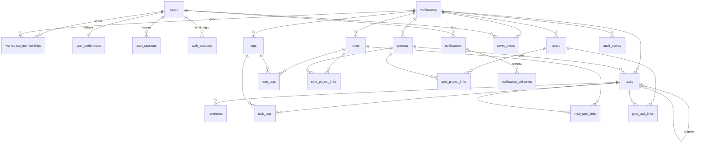

# Veri Modeli

> Durum: v0.3 · Son güncelleme: 2026-10-15 · Uygulama durumu: Şema oluşturulmadı, migration yok.
> PostgreSQL + Drizzle ONAYLI (D-044); Docker Desktop üzerinde yerel (D-056). Alan ayrıntıları ve sınırlar D-060 ile onaylı; D-061 sadeleştirmeleri uygulanmıştır.
> Veritabanı: PostgreSQL 16+ (ONAYLI, D-044). Bu belgedeki alanlar **hedef şemadır**; açık sorulara bağlı alanlar işaretlenmiştir.

## 1. Genel kurallar

| Konu | Kural |
|---|---|
| Birincil anahtar | `id uuid` — uygulamada üretilen UUIDv7 (D-015). Bağlantı tablolarında bileşik PK. |
| Zaman damgaları | `created_at`, `updated_at` — `timestamptz NOT NULL DEFAULT now()`; `updated_at` uygulama tarafından güncellenir. |
| Tarih türleri | Tüm gün: `date`; anlık: `timestamptz`; saat dilimi: `text` (IANA). Bkz. BR-DATE-001. |
| İsimlendirme | Tablolar çoğul `snake_case`; kolonlar `snake_case`; TS tarafında `camelCase` eşlemesi. |
| Çalışma alanı | Tüm içerik tablolarında `workspace_id uuid NOT NULL` (BR-WS-002). |
| Yumuşak silme | `archived_at timestamptz NULL`, `deleted_at timestamptz NULL`, `deleted_batch_id uuid NULL` (BR-DEL-*). |
| Eşzamanlılık | Düzenlenebilir varlıklarda `version integer NOT NULL DEFAULT 1` (D-018). |
| Enum'lar | PostgreSQL enum yerine `text` + `CHECK (... IN (...))` — değer eklemek daha kolay migration gerektirir. |
| Metin uzunlukları | `text` + `CHECK (char_length(...) <= n)`. |
| Uzantılar | `citext` (gerekirse), `unaccent`, `pg_trgm`. |
| Para/plan | MVP'de yok (D-021). |

## 2. ER diyagramı



## 3. Varlıklar

Gösterim: **Z** = zorunlu (NOT NULL), **İ** = isteğe bağlı.

### 3.1. `users` — modül: identity
Amaç: Hesap sahibi kişi. Kimlik doğrulama kütüphanesinin beklediği alanları içerir (ayrıntılar Better Auth şemasına göre Faz 3'te kesinleşir).

| Alan | Tür | Z/İ | Açıklama / kısıt |
|---|---|---|---|
| id | uuid | Z | PK |
| email | text | Z | Normalize edilmiş (BR-ACC-001); `UNIQUE` |
| email_verified_at | timestamptz | İ | BR-ACC-004 |
| name | text | Z | 1–100 karakter |
| image_url | text | İ | Avatar (MVP: baş harfler; yükleme SONRA) |
| deletion_requested_at | timestamptz | İ | BR-ACC-005 |
| created_at, updated_at | timestamptz | Z | |

İndeks: `UNIQUE (email)`. Silme: BR-ACC-005 süreciyle kalıcı silme; tüm bağlı kayıtlar kaskad veya iş ile temizlenir.

### 3.2. `auth_sessions`, `auth_accounts`, `auth_verifications` — modül: identity
Kimlik doğrulama kütüphanesine aittir. `auth_accounts` şifre hash'ini (veya ileride OAuth sağlayıcı bağlantısını) tutar; `users` tablosunda şifre **yoktur**. `auth_sessions`: `id`, `user_id`, `token_hash`, `expires_at`, `ip_address`, `user_agent`, `created_at`. `auth_verifications`: e-posta doğrulama ve şifre sıfırlama token'ları (yalnızca hash'leri), `expires_at`.

### 3.3. `workspaces` — modül: workspaces

| Alan | Tür | Z/İ | Açıklama / kısıt |
|---|---|---|---|
| id | uuid | Z | PK |
| type | text | Z | `CHECK IN ('personal','shared')` |
| name | text | Z | 1–80 |
| owner_user_id | uuid | Z | FK → users |
| created_at, updated_at | timestamptz | Z | |
| deleted_at | timestamptz | İ | Yalnızca paylaşılan alanlar (Faz 10) |

İndeks: `UNIQUE (owner_user_id) WHERE type='personal'` (BR-WS-001).

### 3.4. `workspace_memberships` — modül: workspaces

| Alan | Tür | Z/İ | Açıklama / kısıt |
|---|---|---|---|
| id | uuid | Z | PK |
| workspace_id | uuid | Z | FK → workspaces ON DELETE CASCADE |
| user_id | uuid | Z | FK → users ON DELETE CASCADE |
| role | text | Z | `CHECK IN ('owner','admin','member','guest')` |
| status | text | Z | `CHECK IN ('active','removed')` |
| created_at, updated_at, removed_at | timestamptz | Z/Z/İ | |

İndeks: `UNIQUE (workspace_id, user_id) WHERE status='active'`; `(user_id, status)`.
Kısıt: Her aktif alanda en az bir `owner` (uygulama kuralı + test; Faz 10).

### 3.5. `user_preferences` — modül: preferences

| Alan | Tür | Z/İ | Varsayılan | Açıklama |
|---|---|---|---|---|
| user_id | uuid | Z | — | PK, FK → users CASCADE |
| locale | text | Z | `tr` | `tr` veya `en` (D-038) |
| timezone | text | Z | tarayıcı | IANA; geçerlilik uygulamada doğrulanır |
| theme | text | Z | `system` | `light/dark/system` |
| density | text | Z | `comfortable` | `comfortable/compact` |
| date_format | text | Z | `DD.MM.YYYY` | izinli liste |
| time_format | text | Z | `24h` | `12h/24h` |
| week_start | smallint | Z | 1 | 0=Pazar, 1=Pazartesi |
| default_task_view | text | Z | `list` | `list/board/calendar` |
| start_page | text | Z | `dashboard` | `dashboard/inbox/my-tasks` |
| all_day_reminder_time | time | Z | `09:00` | BR-REM-001 |
| dashboard_layout | jsonb | Z | varsayılan liste | BR-DASH-001; Zod şemalı, `{v:1, widgets:[{id, visible}]}` |
| notification_settings | jsonb | Z | varsayılan | BR-NOTIF-004; MVP: `{v:1, reminder:{inApp:true}}` — yalnızca uygulama içi (D-037). E-posta kanalı ve günlük özet eklenirse şema `v:2` olur. |
| onboarding | jsonb | Z | `{}` | `{v:1, intents:[], completedAt, skippedAt, checklist:{...}}` |
| version | int | Z | 1 | |
| updated_at | timestamptz | Z | | |

JSONB alanları her zaman sürümlü bir Zod şemasıyla okunur/yazılır; okunamayan değer varsayılana düşer ve loglanır.

### 3.6. `projects` — modül: projects

| Alan | Tür | Z/İ | Açıklama / kısıt |
|---|---|---|---|
| id | uuid | Z | PK |
| workspace_id | uuid | Z | FK → workspaces |
| kind | text | Z | `CHECK IN ('inbox','standard')` — D-030 |
| name | text | Z | 1–120 (BR-PROJ-001) |
| description | text | İ | ≤ 5.000 |
| color | text | Z | Tasarım sistemindeki renk anahtarı (`slate`, `indigo`…) |
| icon | text | İ | İzinli simge adı |
| status | text | Z | `active/on_hold/completed` (BR-PROJ-002) |
| position | text | Z | Kenar çubuğu sıralaması (fractional index) |
| created_by | uuid | Z | FK → users |
| archived_at, deleted_at | timestamptz | İ | |
| deleted_batch_id | uuid | İ | |
| version | int | Z | |
| created_at, updated_at | timestamptz | Z | |

İndeksler / kısıtlar:
- `UNIQUE (workspace_id, id)` — bileşik FK hedefi (BR-WS-002).
- `UNIQUE (workspace_id) WHERE kind='inbox'` (BR-PROJ-006).
- `CHECK (kind <> 'inbox' OR (archived_at IS NULL AND deleted_at IS NULL))`.
- `(workspace_id, position) WHERE deleted_at IS NULL AND archived_at IS NULL`.

### 3.7. `tasks` — modül: tasks

| Alan | Tür | Z/İ | Açıklama / kısıt | Kural |
|---|---|---|---|---|
| id | uuid | Z | PK | |
| workspace_id | uuid | Z | | BR-WS-002 |
| project_id | uuid | Z | Bileşik FK `(workspace_id, project_id)` → projects | BR-TASK-002 (D-030) |
| parent_task_id | uuid | İ | Bileşik FK `(workspace_id, parent_task_id)` → tasks | BR-SUB-001/002 |
| title | text | Z | 1–500 | BR-TASK-001 |
| description | text | İ | ≤ 20.000, Markdown | |
| status | text | Z | `todo/in_progress/done` | BR-TASK-003 (D-041) |
| priority | smallint | Z | 0–3, varsayılan 0 | BR-TASK-005 |
| start_date | date | İ | | BR-DATE-002 |
| due_date | date | İ | | BR-DATE-001 |
| due_time | time | İ | yalnızca `due_date` varsa | BR-DATE-001 |
| timezone | text | İ | `due_time` varsa zorunlu | BR-DATE-001 |
| due_at | timestamptz | İ | Hesaplanmış; `due_time` varsa zorunlu | BR-DATE-001/006 |
| completed_at | timestamptz | İ | | BR-TASK-004 |
| completed_by | uuid | İ | FK → users | |
| position | text | Z | Proje/ebeveyn içinde sıralama | BR-TASK-006 |
| recurrence_rule | text | İ | RRULE alt kümesi | BR-REC-003 |
| recurrence_mode | text | İ | `fixed_schedule/after_completion` | BR-REC-002 (D-033) |
| recurrence_series_id | uuid | İ | Aynı serideki örnekler | BR-REC-* |
| recurrence_generated_from | uuid | İ | Bu örneği üreten tamamlanmış görev | BR-REC-007 |
| created_by | uuid | Z | | |
| archived_at, deleted_at | timestamptz | İ | | BR-DEL-* |
| deleted_batch_id | uuid | İ | | BR-DEL-006 |
| search_vector | tsvector | Z | Üretilmiş kolon: `title` (A) + `description` (B), `unaccent` + `simple` | D-022 |
| version | int | Z | | BR-TASK-010 |
| created_at, updated_at | timestamptz | Z | | |

CHECK kısıtları:
```sql
CHECK (char_length(btrim(title)) BETWEEN 1 AND 500)
CHECK (priority BETWEEN 0 AND 3)
CHECK (status IN ('todo','in_progress','done'))
CHECK ((status = 'done') = (completed_at IS NOT NULL))
CHECK (start_date IS NULL OR due_date IS NULL OR start_date <= due_date)
CHECK (due_time IS NULL OR (due_date IS NOT NULL AND timezone IS NOT NULL AND due_at IS NOT NULL))
CHECK (recurrence_rule IS NULL OR (due_date IS NOT NULL AND parent_task_id IS NULL))
CHECK (parent_task_id IS NULL OR parent_task_id <> id)
```
Tek seviye alt görev (BR-SUB-001) ve ebeveynle aynı proje (BR-SUB-002) uygulama katmanında zorunludur ve testlerle korunur; veritabanı trigger'ı kullanılmaz (D-061).

İndeksler (hepsi `WHERE deleted_at IS NULL` kısmi):
- `(workspace_id, project_id, status, position)` — proje listesi ve board.
- `(workspace_id, due_date) WHERE status <> 'done' AND archived_at IS NULL` — bugün/geciken/yaklaşan/takvim.
- `(workspace_id, due_at) WHERE due_at IS NOT NULL AND status <> 'done'`.
- `(parent_task_id)`.
- `(recurrence_series_id)`.
- `GIN (search_vector)`; `GIN (title gin_trgm_ops)` — kısa sorgular.
- Çöp için: `(workspace_id, deleted_at) WHERE deleted_at IS NOT NULL`.

### 3.8. `tags`, `task_tags`, `note_tags` — modül: tags

`tags`: `id`, `workspace_id`, `name` (1–50), `name_normalized` (Türkçe küçük harf + `unaccent`), `color`, `created_at`, `updated_at`. `UNIQUE (workspace_id, name_normalized)` (BR-TAG-001).

`task_tags`: `task_id`, `tag_id`, `workspace_id`; PK `(task_id, tag_id)`; her iki FK bileşik (`workspace_id` ile) ve `ON DELETE CASCADE`. İndeks `(tag_id)`.
`note_tags`: aynı yapı, `note_id`.

### 3.9. `reminders` — modül: reminders

| Alan | Tür | Z/İ | Açıklama |
|---|---|---|---|
| id | uuid | Z | PK |
| workspace_id | uuid | Z | |
| task_id | uuid | Z | Bileşik FK, CASCADE |
| recipient_user_id | uuid | Z | MVP: görev sahibi |
| kind | text | Z | `absolute/relative` |
| offset_minutes | int | İ | `relative` için zorunlu, ≥ 0 |
| remind_at | timestamptz | Z | Hesaplanmış (relative) veya girilen (absolute) |
| status | text | Z | `pending/sent/canceled/skipped/failed` |
| sent_at | timestamptz | İ | |
| created_at, updated_at | timestamptz | Z | |

Kısıtlar: `UNIQUE (task_id, remind_at)`; `CHECK (kind <> 'relative' OR offset_minutes IS NOT NULL)`.
İndeks: `(remind_at) WHERE status='pending'` — dispatch işi.

### 3.10. `notes` ve bağlantılar — modül: notes

`notes`:
| Alan | Tür | Z/İ | Açıklama |
|---|---|---|---|
| id, workspace_id | uuid | Z | |
| title | text | İ | ≤ 200; boşsa arayüz gövdeden türetir |
| body | text | Z | Markdown, ≤ 200.000, varsayılan `''` |
| pinned_at | timestamptz | İ | |
| created_by | uuid | Z | |
| archived_at, deleted_at, deleted_batch_id | | İ | |
| search_vector | tsvector | Z | Üretilmiş |
| version | int | Z | BR-NOTE-002 |
| created_at, updated_at | timestamptz | Z | |

`CHECK (char_length(coalesce(title,'')) + char_length(body) > 0)` (BR-NOTE-004).

`note_task_links (note_id, task_id, workspace_id, created_at)` ve `note_project_links (note_id, project_id, workspace_id, created_at)` — PK bileşik, bileşik FK'lar, CASCADE. Polimorfik (`target_type/target_id`) bağlantı **kullanılmaz**, çünkü referans bütünlüğü sağlanamaz.

### 3.11. `goals` ve bağlantılar — modül: goals

`goals`: `id`, `workspace_id`, `title` (1–200), `description` (≤ 5.000), `target_date date`, `status` (`active/achieved/abandoned`), `progress_mode` (`auto/manual`, varsayılan `auto`, D-034), `manual_progress smallint CHECK 0–100`, `achieved_at`, `created_by`, `archived_at`, `deleted_at`, `deleted_batch_id`, `version`, zaman damgaları.
`goal_task_links (goal_id, task_id, workspace_id)` ve `goal_project_links (goal_id, project_id, workspace_id)`.

### 3.12. `notifications`, `notification_deliveries` — modül: notifications

`notifications`:
| Alan | Tür | Z/İ | Açıklama |
|---|---|---|---|
| id | uuid | Z | |
| user_id | uuid | Z | Alıcı |
| workspace_id | uuid | İ | İlgili alan |
| type | text | Z | MVP: yalnızca `reminder` (günlük özet MVP dışı, D-054) |
| entity_type, entity_id | text, uuid | İ | Gidilecek kayıt (bilgi amaçlı; FK değil — kayıt silinebilir) |
| payload | jsonb | Z | Gösterim verisi (tür bazında Zod şeması); **görev başlığının anlık kopyası** |
| dedupe_key | text | Z | BR-NOTIF-002 |
| read_at | timestamptz | İ | |
| created_at | timestamptz | Z | |

`UNIQUE (user_id, dedupe_key)`; indeks `(user_id, created_at DESC)`, `(user_id) WHERE read_at IS NULL`.

`notification_deliveries` — **SONRA** (D-037: MVP'de yalnızca uygulama içi): `id`, `notification_id` (CASCADE), `channel` (`email`), `status`, `attempts`, `last_error`, `sent_at`. `UNIQUE (notification_id, channel)`. MVP'de oluşturulmaz.

### 3.13. `saved_views` — modül: views
`id`, `workspace_id`, `owner_user_id`, `name` (1–60), `view_type` (`list/board/calendar`), `filter jsonb` (`TaskFilter` v1), `sort jsonb`, `group_by text`, `position`, `pinned boolean`, `version`, zaman damgaları. Kullanıcı başına ≤ 50 (BR-VIEW-001).

### 3.14. `audit_events` — modül: audit
`id`, `workspace_id` (İ), `actor_user_id` (İ — hesap silindikten sonra NULL), `action` (`auth.sign_in`, `auth.password_changed`, `task.deleted`, `project.restored`, `trash.purged`…), `entity_type`, `entity_id`, `metadata jsonb` (içerik değil yalnızca kimlikler/sayılar), `ip_hash`, `created_at`. Saklama: 1 yıl (D-060). Salt eklenir (update/delete yok; yalnızca saklama işi siler).

### 3.15. Teknik tablolar
- `idempotency_keys`: `user_id`, `key`, `request_hash`, `response_status`, `response_body jsonb`, `created_at`; PK `(user_id, key)`; 24 saat sonra silinir (D-019).
- `outbox_events` — **SONRA** (e-posta bildirimleri eklendiğinde; D-037): işlem içinde yazılan asenkron olaylar.
- ~~`data_exports`~~ — kaldırıldı: dışa aktarma doğrudan indirme olarak üretilir (D-046).
- ~~pg-boss şeması~~ — kaldırıldı (D-044). Zamanlanmış işlerin son çalışma bilgisi gerekiyorsa küçük bir `maintenance_runs` (`job`, `last_run_at`) tablosu eklenir (D-053: bakım işleri uygulama çalışırken açılışta ve saatte bir çalışır).

### 3.16. `legal_acceptances` — modül: identity (yayına alma öncesi; MVP'de oluşturulmaz — D-061)
Amaç: Kullanım koşullarının hangi sürümünün ne zaman kabul edildiğini kanıtlamak (LEGAL REQ-LGL-05).
`id`, `user_id` (CASCADE), `document` (`terms` | ileride diğerleri), `version` (text), `accepted_at`. `UNIQUE (user_id, document, version)`. Yalnızca başka kullanıcılar kayıt olmadan önce (yayına alma) gerekir; yerel MVP'de tablo ve kabul akışı yoktur.

## 4. İlişkiler ve silme davranışları özeti

| Üst → alt | FK davranışı (DB) | Uygulama davranışı | Kural |
|---|---|---|---|
| workspace → içerik | `ON DELETE CASCADE` (yalnızca kalıcı silmede devreye girer) | Kişisel alan yalnızca hesap silmede silinir | BR-WS-001 |
| project → tasks | `ON DELETE RESTRICT` | Proje kalıcı silinmeden önce görevleri use case siler | BR-PROJ-005, BR-DEL-005 |
| task → subtasks | `ON DELETE CASCADE` | Yumuşak silmede aynı grup | BR-SUB-004 |
| task → reminders, task_tags, links | `ON DELETE CASCADE` | | BR-DEL-005 |
| tag → task_tags/note_tags | `ON DELETE CASCADE` | Etiket kalıcı silinir | BR-TAG-002 |
| note/goal → links | `ON DELETE CASCADE` | | BR-NOTE-003, BR-GOAL-004 |
| user → memberships, sessions, preferences | `ON DELETE CASCADE` | Hesap silme işi | BR-ACC-005 |

`RESTRICT` kullanımı bilinçlidir: projeyi kalıcı silen kod görevleri unutursa veritabanı hatası alınır, sessiz veri kaybı olmaz.

## 5. İndeks stratejisi
- Her sorgu kalıbı için indeks yukarıda listelendi; yeni sorgu kalıbı eklendiğinde `EXPLAIN ANALYZE` ile kontrol edilir ve bu belge güncellenir.
- Kısmi indeksler aktif kayıtlara odaklanır (`deleted_at IS NULL`).
- Bileşik FK'ler için `(workspace_id, id)` benzersiz indeksleri gereklidir.

## 6. Saat dilimi yaklaşımı
- Veritabanı oturum saat dilimi `UTC`.
- Kullanıcı "bugün"ü sorgularda parametre olarak gönderilir (sunucuda `shared/time` ile kullanıcının saat diliminden hesaplanır); SQL içinde `now()::date` kullanılmaz.
- Ayrıntılı kurallar BR-DATE-001..006.

## 7. Migration stratejisi
Ayrıntı: ARCHITECTURE §12.4. Ek kurallar:
- Her migration ileri yönlüdür; geri alma, yeni bir düzeltici migration ile yapılır.
- Her migration'ın bir PR açıklaması vardır: amaç, kilit etkisi, veri dönüşümü var mı, geri dönüş planı.
- Tablo/kolon adı değişikliği bu belgenin güncellenmesini gerektirir.


### 7.1. Uygulanan migration'lar
| No | Dosya | İçerik | Faz |
|---|---|---|---|
| 0000 | `drizzle/0000_extensions.sql` | `unaccent`, `pg_trgm` uzantıları | 2 |

Faz 3'ün ilk migration'ı: `users` ve kimlik doğrulama tabloları, `workspaces`, `workspace_memberships`, `user_preferences`, `idempotency_keys`, `audit_events`.
## 8. Başlangıç ve test verileri
- **Sistem verisi:** Yok (roller kodda sabit, D-014). Inbox projesi kullanıcı kaydında oluşturulur.
- **Onboarding örnek verisi:** Kullanıcının seçimine göre (ONBOARDING §3) oluşturulur, `onboarding_sample` etiketiyle değil, normal kayıt olarak; kullanıcı silebilir. Örnek içerik oluşturma isteğe bağlıdır (onboarding: Figma tasarımı esas, D-063).
- **Geliştirme seed'i:** `pnpm db:seed` — 2 kullanıcı (yalnızca yerel ortam), her biri için Inbox, 5 proje, 200 görev (tarih dağılımlı: geciken/bugün/gelecek/tarihsiz), alt görevler, etiketler, 1 tekrarlayan seri, notlar, hedefler. Seed kimlik bilgileri yalnızca `.env.example`/seed dosyasında, gerçek değil.
- **Test fabrikaları:** `tests/fixtures/factories.ts` — `makeUser()`, `makeWorkspaceWithOwner()`, `makeTask({...})`; her test kendi verisini oluşturur, paylaşılan durum yok.

## 9. Veri izolasyonu
- Tüm içerik sorguları `workspace_id` ile filtrelenir (ARCHITECTURE §6).
- Bileşik FK'ler çapraz alan bağlantısını veritabanı düzeyinde imkânsız kılar (BR-WS-002).
- Bildirimler kullanıcıya bağlıdır; listelenirken `user_id = actor` zorunludur.

## 10. Veri yaşam döngüsü ve saklama

Bu tablo, lansman öncesinde Saklama ve İmha Politikası'nın kaynağıdır (LEGAL §6). Silme işleri uygulama çalışırken (açılışta ve periyodik) yürür; uygulama kapalıyken çalışmaz (D-053).

| Veri | Saklama | Silinme yolu | Durum |
|---|---|---|---|
| Aktif içerik | Hesap var oldukça | Kullanıcı eylemi | — |
| Çöpteki içerik | 30 gün | `trash.purgeExpired` | ONAYLI (D-035) |
| Silinen hesap | 14 gün iptal edilebilir bekleme, sonra kalıcı | `accounts.purgeDeleted` | ONAYLI (D-036) |
| Bildirimler | 90 gün | `notifications.cleanup` | ONAYLI (D-060) |
| Idempotency anahtarları | 24 saat | `idempotency.cleanup` | ONAYLI (D-060) |
| Oturumlar | Süre dolunca | Kütüphane + temizlik | ONAYLI (D-060) |
| Denetim olayları | 1 yıl | Saklama işi | ONAYLI (D-060) |
| Dışa aktarma | Saklanmaz (doğrudan indirme) | — | ONAYLI (D-046, D-060) |
| Yerel yedekler | Son 7 yedek | `pnpm db:backup` eski yedekleri siler | ONAYLI (D-036, D-060; LEGAL §6.1) |
| Yayındaki yedekler | 35 gün | Sağlayıcı saklama politikası | Ertelendi (OQ-032) |
| Uygulama logları | Yerelde terminal/dosya; dosya kullanılırsa 30 gün | Log döndürme | ONAYLI (D-060) |
