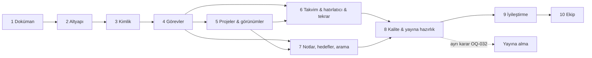

# Aşamalı Geliştirme Planı

> Durum: v0.5 · Son güncelleme: 2026-10-28
> v0.2: OQ-001..OQ-023 kararları işlendi. Çalışma ortamı yalnızca yerel (D-045); "beta" ve "yayına alma" ayrı bir karara bağlandı (OQ-032).

## 1. Faz durumu (tek gerçek kaynak)

| Faz | Ad | Durum | Engelleyen açık sorular | Başlangıç | Kapanış |
|---|---|---|---|---|---|
| 1 | Ürün analizi, mimari kararlar, dokümantasyon | **Kapandı** | — | 2026-10-27 | 2026-10-27 |
| 2 | Proje altyapısı ve temel mimari | **Kapandı** | — | 2026-10-28 | 2026-10-28 |
| 3 | Kimlik doğrulama, hesap, tercihler, onboarding | **Devam ediyor** | D-065 ekranları onaya sunulacak | 2026-10-28 | — |
| 4 | Görev yönetimi, Inbox, My Tasks, dashboard | Başlamadı | — | — | — |
| 5 | Projeler ve görev görünümleri | Başlamadı | — | — | — |
| 6 | Takvim, hatırlatıcılar, tekrarlayan görevler, bildirimler | Başlamadı | — | — | — |
| 7 | Notlar, hedefler, arama | Başlamadı | Not editörü paketi seçimi (Faz 7 başında sunulur) | — | — |
| 8 | Test, güvenlik, kalite; dışa aktarma, hesap silme | Başlamadı | — | — | — |
| 9 | Kullanım geri bildirimine göre iyileştirmeler | Başlamadı | — | — | — |
| 10 | (Doğrulanırsa) Ekip ve paylaşılan çalışma alanları | Başlamadı | Ayrı karar seti; yayına alma (OQ-032); abonelik yönü D-048 | — | — |

Durum değerleri: `Başlamadı` · `Devam ediyor` · `Kapı kontrolünde` · `Kapandı`.

Yayına alma (hosting, alan adı, e-posta sağlayıcı, hata izleme, yasal metinlerin yayımı) **hiçbir fazın parçası değildir**. Ürün sahibinin ayrı kararıyla (OQ-032) ve LEGAL §9 kontrol listesi tamamlandıktan sonra yapılır.

## 2. Fazlar arası bağımlılık



Not: Görev modülü Inbox'a bağımlı olduğundan (D-030), Faz 4'te `projects` modülünün **çekirdeği** (Inbox ve basit proje oluşturma) da kurulur; proje yönetimi ekranları Faz 5'tedir.

## 3. Faz kapısı (gate) kontrolü

Bir faz ancak şu koşulların **tamamı** sağlanınca kapanır ve sonraki faz başlar:

1. Fazın teslim listesi tamamlandı.
2. Fazın kabul kriterleri karşılandı ve kanıtlandı (test çıktısı, ekran görüntüsü/E2E kaydı).
3. `pnpm verify` tamamen yeşil; faz kapanışı testleri (TESTING_STRATEGY §8) çalıştırıldı; BR izlenebilirlik raporunda fazın `ONAYLI` kuralları için eksik test yok.
4. İlgili belgeler güncel (kod ↔ belge tutarlılık kontrolü, CLAUDE.md §7).
5. Bir sonraki fazı engelleyen açık sorular yanıtlandı.
6. Claude, faz kapanış raporunu sundu: yapılanlar, test sonuçları, alınan kararlar, bilinen riskler/teknik borç.
7. **Ürün sahibi kapanışı onayladı**; onay DECISIONS.md "Faz kapanış kayıtları" tablosuna işlendi ve §1 tablosu güncellendi.

Claude bir faz kapanmadan sonraki fazın kodunu yazmaz. Önceki fazda bulunan bir hata sonraki fazda düzeltilebilir (regresyon testiyle), ancak yeni kapsam eklenmez.

## 4. Fazlar

### Faz 1 — Ürün analizi, mimari kararlar ve dokümantasyon
- **Kapsam:** Bu belge seti.
- **Teslim:** README, CLAUDE.md, docs/* (18 belge).
- **Durum:** Kapandı (2026-10-27). OQ-001..OQ-034 kapandı (D-030..D-063); yalnızca OQ-032 ertelendi.
- **Kabul:** Teknik öneriler onaylandı (D-060); ürün/UX ayrıntıları onaylandı (OQ-034); Faz 2–3'ü engelleyen OQ'lar yanıtlandı.
- **Kapanış eylemi:** OQ-034 ile onaylanan ayrıntılar `ONAYLI` yapılır; ürün sahibi "Faz 1 kapandı" der; DECISIONS §5'e işlenir.

### Faz 2 — Proje altyapısı ve temel mimari
- **Bağımlılık:** Faz 1 (D-053, D-056, D-057, D-058 kararları hazır).
- **Kapsam ve teslimler:**
  - Yerel Git deposu (D-057), pnpm, TS strict, ESLint/Prettier, `dependency-cruiser` kuralları, özel lint kuralları.
  - Next.js iskeleti, `src/` klasör yapısı (ARCHITECTURE §5.2), boş modül iskeletleri.
  - Docker Compose ile yerel PostgreSQL ve Mailpit (D-056); `.env.example`; Zod ile ortam değişkeni doğrulama.
  - Drizzle kurulumu, ilk migration, migration komutları; `pnpm db:backup` / `pnpm db:restore` betikleri. **Sapma (teknik):** İlk migration yalnızca arama uzantılarını (`unaccent`, `pg_trgm`) kurar. Planlanan tabloların hepsi `users` tablosuna yabancı anahtarla bağlı olduğu için, `users` ile birlikte Faz 3'ün ilk migration'ına taşındı; böylece yabancı anahtarsız geçici tablo oluşmadı.
  - `shared/kernel` (Result, DomainError, ID, Clock), `shared/http` (hata eşleyici, requestId), `shared/observability` (pino). **Sapma:** Origin kontrolü, idempotency ve hız sınırı ilk uç noktalarıyla birlikte Faz 3'te (kullanılacakları yerde) eklenir.
  - `Scheduler` arayüzü ve uygulama içi adaptör (açılışta + saatte bir, veritabanı kilidiyle; D-053). Faz 2'de kayıtlı iş yok; ilk iş (çöp temizliği) Faz 4'te.
  - `EmailSender` arayüzü, Mailpit SMTP adaptörü ve testler için bellek içi adaptör; ücretli servis yok.
  - Test altyapısı: Vitest, Playwright, Testcontainers ile gerçek PostgreSQL (D-056); diğer test paketleri ihtiyaç duyuldukça (D-058); fabrikalar.
  - `pnpm verify` doğrulama komutu ve git hook'ları (TESTING_STRATEGY §8); BR izlenebilirlik betiği.
  - Tasarım token'ları **Figma'dan birebir** (D-063; renk, tipografi, boşluk, köşe, gölge), temel bileşenler: Button, Input, Chip, Progress, Banner, Toast (görünüm), EmptyState, Skeleton; Figma ikonları. **Sapma:** Dialog, ilk kullanıldığı Faz 4'e bırakıldı (D-058). Açık temadaki iki eksik değer D-066 ile eklendi; tema seçimi Faz 3'te etkinleşir.
  - i18n iskeleti, Türkçe + İngilizce (D-038).
  - Sağlık uç noktaları.
- **Kabul:** README'deki adımlarla temiz bir Windows makinesinde uygulama yerelde çalışır; `pnpm verify` tüm adımlarıyla yeşil; mimari kural ihlali içeren örnek kod doğrulamada yakalanıyor (denendi); `/api/health/ready` 200; yedek alma ve geri yükleme betiği denendi; test e-postası yerel yakalayıcıda görüldü.
- **Sonuç (2026-10-28):** Teslimler tamamlandı; üç sapma (ilk migration kapsamı; Origin kontrolü, idempotency ve hız sınırının Faz 3'e kalması; Dialog'un Faz 4'e kalması) yukarıda belirtildi. Kabul koşulları:
  - `pnpm verify` 12 adımın tamamıyla yeşil: kilit dosyası, biçim, lint, tip, mimari, kural izlenebilirliği, 20 birim, migration kontrolü, 9 entegrasyon, derleme, 10 tarayıcı testi, bağımlılık denetimi.
  - Bilerek eklenen bir katman ihlali (domain → veritabanı) mimari denetimde yakalandı.
  - `/api/health/ready` 200 döndü.
  - Yedek alma ve geri yükleme döngüsü denendi.
  - Test e-postası Mailpit'te görüldü (otomatik entegrasyon testi).
  - "README adımlarıyla temiz bir makinede kurulum" bu bilgisayarda doğrulandı; ikinci bir makinede denenmedi.

### Faz 3 — Kimlik doğrulama, hesap, tercihler, onboarding
- **Bağımlılık:** Faz 2; Figma ekranları (D-063).
- **Kapsam:** FR-AUTH-01..07 (e-posta + şifre, D-039), BR-ACC-001..004, BR-ACC-006, BR-WS-001, BR-PREF-001..003; güvenlik e-postaları ve şifreyle yeniden doğrulama (D-040, D-055); ayarlar (profil, görünüm, dil TR/EN, tarih/saat, güvenlik/oturumlar); onboarding (ONBOARDING §2–3); uygulama kabuğu (kenar çubuğu, Inbox'ın menüde ayrı girişi D-030, mobil navigasyon, boş dashboard).
- **Kabul:** Kayıt → kişisel alan + Inbox + tercihler tek işlemde; giriş/çıkış/sıfırlama/doğrulama E2E (e-postalar yerel yakalayıcıdan okunarak); hız sınırları test edildi; numaralandırma önlemleri test edildi; ayar değişiklikleri kalıcı; arayüz TR/EN geçişi çalışıyor.

### Faz 4 — Görev yönetimi, Inbox, My Tasks, dashboard
- **Bağımlılık:** Faz 3.
- **Kapsam:** FR-TASK-01..09, FR-INBOX-01..03, FR-DASH-01..05 (+ 06..08 P1), etiketler, alt görevler (D-032), durumlar (D-041), görev arşivi (salt okunur, D-043) / çöp / geri yükleme, 30 günlük çöp temizliği (D-035), tarih modeli (BR-DATE-001..005; DST testleri), idempotency, eşzamanlılık, hızlı ekleme, görev detay paneli, temel klavye kısayolları, "İlk adımlar" listesi. Faz sonunda TanStack Query ihtiyacı değerlendirilir (ARCHITECTURE §3.7); gerekiyorsa gerekçeyle onaya sunulur.
- **Kabul:** AC-01, AC-02, AC-03, AC-07, AC-09 E2E'de geçer; ilgili BR testleri tam; 1.000 görevli seed ile liste p95 < 300 ms (yerel ölçüm).

### Faz 5 — Projeler ve görev görünümleri
- **Bağımlılık:** Faz 4.
- **Kapsam:** FR-PROJ-01..06 (silmede proje + görevler birlikte çöpe, D-031), FR-VIEW-01..02, 04..08; board sürükle-bırak; toplu işlemler (BR-TASK-008); kayıtlı görünümler (filtre + sıralama, D-051); arşiv ve çöp sayfaları.
- **Kabul:** AC-06; görünüm geçişinde filtre korunumu E2E; toplu işlem atomikliği; proje ilerlemesi doğru.

### Faz 6 — Takvim, hatırlatıcılar, tekrarlayan görevler, bildirimler
- **Bağımlılık:** Faz 5.
- **Kapsam:** FR-CAL-01..06 (masaüstü hafta/ay sürükle-bırak, mobilde tarih seçici — D-047), BR-REM-001..005, BR-REC-001..007 (iki mod, tamamlanınca üretim — D-033), BR-DATE-006, uygulama içi bildirimler (D-037), FR-NOTIF-01, 02, 04, 05.
- **Kabul:** AC-04, AC-05; tekrar kuralı özellik tabanlı testleri; paralel bildirim oluşturma testi (tek bildirim); uygulama kapalıyken geçen hatırlatıcılar (E18); DST testleri.

### Faz 7 — Notlar, hedefler, arama
- **Bağımlılık:** Faz 5; not editörü paketinin onayı.
- **Kapsam:** FR-NOTE-01..05 (sade Markdown editör, D-042), FR-GOAL-01..04 (otomatik/manuel ilerleme, D-034), FR-SRCH-01..04, dashboard Projeler/Hedefler widget'ları, bağlantılar, Markdown sanitizasyonu.
- **Kabul:** AC-08, AC-10; XSS yük testleri; hedef ilerleme testleri.

### Faz 8 — Test, güvenlik, kalite; dışa aktarma, hesap silme; yayına hazırlık
- **Bağımlılık:** Faz 6, 7.
- **Kapsam:** Hesap silme (14 gün, D-036), JSON dışa aktarma (D-046, kapsam D-059, şifreyle yeniden doğrulama D-055), SECURITY.md `[MVP]` maddelerinin denetimi, CSP sıkılaştırma, erişilebilirlik denetimi (AC-11, ekran okuyucu manuel testleri), performans testi (10.000 görev), yerel yedekten geri yükleme denemesi, LEGAL gereksinimlerinden yerel MVP'de anlamlı olanlar (dışa aktarma, silme, saklama süreleri). Koşul kabul kaydı ve yasal sayfalar yayına alma öncesine ertelendi (D-061).
- **Kapsam dışı:** Yayına alma, analitik (D-052), hata izleme servisi.
- **Kabul:** SECURITY §13 MVP sütunu tamamen ✔; NFR-01..06 yerelde ölçüldü ve karşılandı; geri yükleme denemesi raporu; açık kritik/ciddi bulgu yok.

### Faz 9 — Kullanım geri bildirimine göre iyileştirmeler
- **Kapsam:** Ürün sahibinin kendi kullanımından (ve yayına alınırsa beta kullanıcılarından) gelen geri bildirim, P1'den kalanlar, P2 adaylarının önceliklendirilmesi (ör. e-posta bildirimleri, Google girişi, PWA, CSV, içe aktarma). Beta yapılacaksa analitik ihtiyacı yeniden değerlendirilir (D-052).
- **Kural:** Her iyileştirme önce PRD/BR güncellemesi ve ürün sahibi onayıyla başlar.

### Faz 10 — Ekip ve paylaşılan çalışma alanları (koşullu)
- **Ön koşul:** Ekip ihtiyacının doğrulanması, yayına alma kararı (OQ-032) ve ayrı bir karar seti (yetki matrisi §6.2 onayı, davet akışı, atama, yorumlar, bildirim türleri, abonelik yönü D-048).
- **Kapsam (taslak):** Paylaşılan alan oluşturma, davet, roller, atama, My Tasks birleşimi, görev değişikliği bildirimleri, paylaşılan görünümler (D-051), RLS değerlendirmesi.

## 5. Faz kapanış raporu şablonu
```md
## Faz N kapanış raporu — YYYY-MM-DD
- Teslim edilenler: …
- Kabul kriterleri ve kanıtları: AC-xx ✔ (E2E çıktısı) …
- Test sonuçları: birim X/X, entegrasyon Y/Y, E2E Z/Z, kapsam …
- Uygulanan iş kuralları: BR-… (testleriyle)
- Alınan kararlar (DECISIONS.md): D-…
- Belgelerde yapılan güncellemeler: …
- Bilinen riskler / teknik borç: …
- Sonraki fazı engelleyen açık sorular: OQ-…
```
