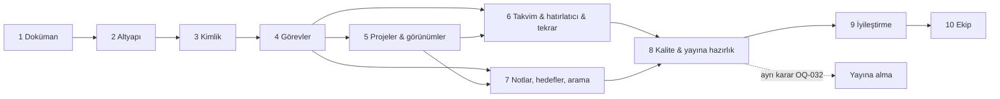

# Aşamalı Geliştirme Planı

> Durum: v0.6 · Son güncelleme: 2026-10-29
> v0.2: OQ-001..OQ-023 kararları işlendi. Çalışma ortamı yalnızca yerel (D-045); "beta" ve "yayına alma" ayrı bir karara bağlandı (OQ-032).

## 1. Faz durumu (tek gerçek kaynak)

| Faz | Ad | Durum | Engelleyen açık sorular | Başlangıç | Kapanış |
|---|---|---|---|---|---|
| 1 | Ürün analizi, mimari kararlar, dokümantasyon | **Kapandı** | — | 2026-10-27 | 2026-10-27 |
| 2 | Proje altyapısı ve temel mimari | **Kapandı** | — | 2026-10-28 | 2026-10-28 |
| 3 | Kimlik doğrulama, hesap, tercihler, onboarding | **Kapandı** | — | 2026-10-28 | 2026-10-28 |
| 4 | Görev yönetimi, Inbox, My Tasks, dashboard | **Kapandı** | — | 2026-10-28 | 2026-10-28 |
| 5 | Projeler ve görev görünümleri | **Kapandı** | — | 2026-10-29 | 2026-10-29 |
| 6 | Takvim, hatırlatıcılar, tekrarlayan görevler, bildirimler | **Kapandı** | — | 2026-10-29 | 2026-10-30 |
| 7 | Notlar, hedefler, arama | **Kapandı** | — | 2026-10-30 | 2026-10-30 |
| 8 | Test, güvenlik, kalite; dışa aktarma, hesap silme | **Kapandı** | — | 2026-10-30 | 2026-10-31 |
| 9 | Kullanım geri bildirimine göre iyileştirmeler | Devam ediyor | — (OQ-045..049 → D-097..D-101) | 2026-10-31 | — |
| 10 | (Doğrulanırsa) Ekip ve paylaşılan çalışma alanları | Başlamadı | Ayrı karar seti; yayına alma (OQ-032); abonelik yönü D-048 | — | — |

Durum değerleri: `Başlamadı` · `Devam ediyor` · `Kapı kontrolünde` · `Kapandı`.

Yayına alma (hosting, alan adı, e-posta sağlayıcı, hata izleme, yasal metinlerin yayımı) **hiçbir fazın parçası değildir**. Ürün sahibinin ayrı kararıyla (OQ-032) ve LEGAL §9 kontrol listesi tamamlandıktan sonra yapılır.

## 2. Fazlar arası bağımlılık



Not: Görev modülü Inbox'a bağımlı olduğundan (D-030), Faz 4'te `projects` modülünün **çekirdeği** (Inbox ve basit proje oluşturma) da kurulur; proje yönetimi ekranları Faz 5'tedir.

## 3. Faz kapısı (gate) kontrolü

Bir faz ancak şu koşulların **tamamı** sağlanınca kapanır ve sonraki faz başlar:

1. Fazın teslim listesi tamamlandı.
2. Fazın kabul kriterleri karşılandı ve kanıtlandı (test çıktısı, ekran görüntüsü/E2E kaydı).
3. `pnpm verify` tamamen yeşil; faz kapanışı testleri (TESTING_STRATEGY §8) çalıştırıldı; BR izlenebilirlik raporunda fazın `ONAYLI` kuralları için eksik test yok.
4. İlgili belgeler güncel (kod ↔ belge tutarlılık kontrolü, CLAUDE.md §7).
5. Bir sonraki fazı engelleyen açık sorular yanıtlandı.
6. Claude, faz kapanış raporunu sundu: yapılanlar, test sonuçları, alınan kararlar, bilinen riskler/teknik borç.
7. **Ürün sahibi kapanışı onayladı**; onay DECISIONS.md "Faz kapanış kayıtları" tablosuna işlendi ve §1 tablosu güncellendi.

Claude bir faz kapanmadan sonraki fazın kodunu yazmaz. Önceki fazda bulunan bir hata sonraki fazda düzeltilebilir (regresyon testiyle), ancak yeni kapsam eklenmez.

## 4. Fazlar

### Faz 1 — Ürün analizi, mimari kararlar ve dokümantasyon
- **Kapsam:** Bu belge seti.
- **Teslim:** README, CLAUDE.md, docs/* (18 belge).
- **Durum:** Kapandı (2026-10-27). OQ-001..OQ-034 kapandı (D-030..D-063); yalnızca OQ-032 ertelendi.
- **Kabul:** Teknik öneriler onaylandı (D-060); ürün/UX ayrıntıları onaylandı (OQ-034); Faz 2–3'ü engelleyen OQ'lar yanıtlandı.
- **Kapanış eylemi:** OQ-034 ile onaylanan ayrıntılar `ONAYLI` yapılır; ürün sahibi "Faz 1 kapandı" der; DECISIONS §5'e işlenir.

### Faz 2 — Proje altyapısı ve temel mimari
- **Bağımlılık:** Faz 1 (D-053, D-056, D-057, D-058 kararları hazır).
- **Kapsam ve teslimler:**
  - Yerel Git deposu (D-057), pnpm, TS strict, ESLint/Prettier, `dependency-cruiser` kuralları, özel lint kuralları.
  - Next.js iskeleti, `src/` klasör yapısı (ARCHITECTURE §5.2), boş modül iskeletleri.
  - Docker Compose ile yerel PostgreSQL ve Mailpit (D-056); `.env.example`; Zod ile ortam değişkeni doğrulama.
  - Drizzle kurulumu, ilk migration, migration komutları; `pnpm db:backup` / `pnpm db:restore` betikleri. **Sapma (teknik):** İlk migration yalnızca arama uzantılarını (`unaccent`, `pg_trgm`) kurar. Planlanan tabloların hepsi `users` tablosuna yabancı anahtarla bağlı olduğu için, `users` ile birlikte Faz 3'ün ilk migration'ına taşındı; böylece yabancı anahtarsız geçici tablo oluşmadı.
  - `shared/kernel` (Result, DomainError, ID, Clock), `shared/http` (hata eşleyici, requestId), `shared/observability` (pino). **Sapma:** Origin kontrolü, idempotency ve hız sınırı ilk uç noktalarıyla birlikte Faz 3'te (kullanılacakları yerde) eklenir.
  - `Scheduler` arayüzü ve uygulama içi adaptör (açılışta + saatte bir, veritabanı kilidiyle; D-053). Faz 2'de kayıtlı iş yok; ilk iş (çöp temizliği) Faz 4'te.
  - `EmailSender` arayüzü, Mailpit SMTP adaptörü ve testler için bellek içi adaptör; ücretli servis yok.
  - Test altyapısı: Vitest, Playwright, Testcontainers ile gerçek PostgreSQL (D-056); diğer test paketleri ihtiyaç duyuldukça (D-058); fabrikalar.
  - `pnpm verify` doğrulama komutu ve git hook'ları (TESTING_STRATEGY §8); BR izlenebilirlik betiği.
  - Tasarım token'ları **Figma'dan birebir** (D-063; renk, tipografi, boşluk, köşe, gölge), temel bileşenler: Button, Input, Chip, Progress, Banner, Toast (görünüm), EmptyState, Skeleton; Figma ikonları. **Sapma:** Dialog, ilk kullanıldığı Faz 4'e bırakıldı (D-058). Açık temadaki iki eksik değer D-066 ile eklendi; tema seçimi Faz 3'te etkinleşir.
  - i18n iskeleti, Türkçe + İngilizce (D-038).
  - Sağlık uç noktaları.
- **Kabul:** README'deki adımlarla temiz bir Windows makinesinde uygulama yerelde çalışır; `pnpm verify` tüm adımlarıyla yeşil; mimari kural ihlali içeren örnek kod doğrulamada yakalanıyor (denendi); `/api/health/ready` 200; yedek alma ve geri yükleme betiği denendi; test e-postası yerel yakalayıcıda görüldü.
- **Sonuç (2026-10-28):** Teslimler tamamlandı; üç sapma (ilk migration kapsamı; Origin kontrolü, idempotency ve hız sınırının Faz 3'e kalması; Dialog'un Faz 4'e kalması) yukarıda belirtildi. Kabul koşulları:
  - `pnpm verify` 12 adımın tamamıyla yeşil: kilit dosyası, biçim, lint, tip, mimari, kural izlenebilirliği, 20 birim, migration kontrolü, 9 entegrasyon, derleme, 10 tarayıcı testi, bağımlılık denetimi.
  - Bilerek eklenen bir katman ihlali (domain → veritabanı) mimari denetimde yakalandı.
  - `/api/health/ready` 200 döndü.
  - Yedek alma ve geri yükleme döngüsü denendi.
  - Test e-postası Mailpit'te görüldü (otomatik entegrasyon testi).
  - "README adımlarıyla temiz bir makinede kurulum" bu bilgisayarda doğrulandı; ikinci bir makinede denenmedi.

### Faz 3 — Kimlik doğrulama, hesap, tercihler, onboarding
- **Bağımlılık:** Faz 2; Figma ekranları (D-063).
- **Kapsam:** FR-AUTH-01..07 (e-posta + şifre, D-039), BR-ACC-001..004, BR-ACC-006, BR-WS-001, BR-PREF-001..003; güvenlik e-postaları ve şifreyle yeniden doğrulama (D-040, D-055); ayarlar (profil, görünüm, dil TR/EN, tarih/saat, güvenlik/oturumlar); onboarding (ONBOARDING §2–3); uygulama kabuğu (kenar çubuğu, Inbox'ın menüde ayrı girişi D-030, mobil navigasyon, boş dashboard).
- **Kabul:** Kayıt → kişisel alan + Inbox + tercihler tek işlemde; giriş/çıkış/sıfırlama/doğrulama E2E (e-postalar yerel yakalayıcıdan okunarak); hız sınırları test edildi; numaralandırma önlemleri test edildi; ayar değişiklikleri kalıcı; arayüz TR/EN geçişi çalışıyor.

- **İlerleme (2026-10-28):**
  - **Tamam:** Veritabanı (kimlik, çalışma alanı, üyelik, Inbox, tercihler, denetim); tek işlemli kayıt (BR-WS-001, D-067); Better Auth ile giriş, çıkış, oturum, şifre sıfırlama, e-posta doğrulama; güvenlik e-postaları (D-055); hız sınırları ve Origin kontrolü; giriş, kayıt, şifremi unuttum ve şifre sıfırlama ekranları (D-069 ile onaylandı); korumalı ana sayfa; uygulama kabuğu (kenar çubuğu, alt navigasyon, mobil Menü; D-071); Bugün ekranında selamlama ve boş durum; `GET/PATCH /me/preferences`; Ayarlar · Görünüm (tema, yoğunluk, dil) ve Ayarlar · Tarih ve saat; çıkış düğmesi (D-072 ile onaylandı); yetki matrisi kontrolü.
  - Ayarlar · Profil (ad, e-posta durumu, doğrulamayı yeniden gönderme, e-posta değiştirme) ve Ayarlar · Güvenlik (şifre değiştirme, oturumlar); `/me*` uç noktaları (D-073).
  - Onboarding: 3 adım, atlama kuralı, örnek projeler, amaca göre dashboard düzeni, Ayarlar'dan yeniden başlatma (D-074).
- **Sonuç (2026-10-28):** Faz 3 kapandı. `pnpm verify` 13/13 yeşil. Kabul ölçütleri karşılandı: tek işlemli kayıt; giriş, çıkış, sıfırlama ve doğrulama E2E; hız sınırları ve numaralandırma önlemleri test edildi; ayar değişiklikleri kalıcı; TR/EN geçişi çalışıyor. Bilinen sapmalar SECURITY §4.2 notlarında: oturum token'ı açık metin, 90 günlük mutlak sınır yok. İkisi de yayına alma öncesi listesinde (OQ-032).

### Faz 4 — Görev yönetimi, Inbox, My Tasks, dashboard
- **Bağımlılık:** Faz 3.
- **Kapsam:** FR-TASK-01..09, FR-INBOX-01..03, FR-DASH-01..05 (+ 06..08 P1), etiketler, alt görevler (D-032), durumlar (D-041), görev arşivi (salt okunur, D-043) / çöp / geri yükleme, 30 günlük çöp temizliği (D-035), tarih modeli (BR-DATE-001..005; DST testleri), idempotency, eşzamanlılık, hızlı ekleme, görev detay paneli, temel klavye kısayolları, "İlk adımlar" listesi. Faz sonunda TanStack Query ihtiyacı değerlendirilir (ARCHITECTURE §3.7); gerekiyorsa gerekçeyle onaya sunulur.
- **Kabul:** AC-01, AC-02, AC-03, AC-07, AC-09 E2E'de geçer; ilgili BR testleri tam; 1.000 görevli seed ile liste p95 < 300 ms (yerel ölçüm).

- **İlerleme (2026-10-28):**
  - **1. bölüm (tamam):** Migration 0003 (`tasks`, `idempotency_keys`); `WorkspaceScope` + `authorize`; görev oluşturma, okuma, güncelleme, tamamlama, yeniden açma, liste; tarih modeli ve yaz saati (BR-DATE-001/002/006); sürüm çakışması (BR-TASK-010); idempotency (BR-TASK-007) ve temizlik işi; `GET /workspaces`.
  - **2. bölüm (tamam):** Inbox ekranı; hızlı ekleme (tarih seçici, öncelik, hata ve tekrar dene); tamamlama ve 5 sn "Geri al"; kenar çubuğunda Inbox sayacı (BR-INBOX-003) ve "Görev ekle"; alt menüde Inbox ve Ekle; Bugün sayfasında hızlı ekleme (BR-INBOX-001) (D-077).
  - **3. bölüm (tamam):** Migration 0004 (`tags`, `task_tags`); alt görevler (BR-SUB-001/002/003/005), etiketler (BR-TAG-001/003), taşıma (BR-INBOX-002) ve ayırma; Görevlerim (BR-INBOX-004, BR-DATE-003/004); görev detay paneli (sürüm çakışmasında otomatik yeniden uygulama veya seçim, BR-TASK-010); Inbox satırında "Projeye taşı" ve mobilde "Tarih ver"; kenar çubuğu ve mobil Menü'de Görevlerim (D-078).
  - **4. bölüm (tamam):** Görev arşivleme ve arşivden çıkarma (BR-DEL-002, BR-SUB-004), çöpe taşıma ve silme grupları (BR-DEL-001/006), geri yükleme (BR-DEL-004), kalıcı silme (BR-DEL-005), 30 günlük temizlik işi (BR-DEL-003, D-035, D-053), çöpteki/arşivdeki kayda doğrudan erişim bandı (BR-DEL-007) (D-079). Toplu işlemler ve Arşiv/Çöp sayfaları plan gereği Faz 5'te.
  - **5. bölüm (tamam):** Bugün bölümleri (FR-DASH-01..04, 08; BR-DASH-001/002), Yaklaşanlar, İlk adımlar (ONBOARDING §4), temel klavye kısayolları ve rehber (D-080).
  - **6. bölüm (tamam):** Faz 4 kabul testleri (AC-01, AC-02, AC-03, AC-07 tarayıcıda; AC-09 domain testinde), 1.000 görevle performans ölçümü (`tests/integration/performance.test.ts`: Inbox, Görevlerim ve Bugün bölümleri p95 ≈ 90 ms, sınır 300 ms), TanStack Query değerlendirmesi (eklenmedi) (D-081).
- **Sonuç (2026-10-28):** Faz 4 kapsamı tamam; `pnpm verify` 13/13 yeşil. Plan gereği Faz 5'e kalanlar: toplu işlemler ve çoklu seçim (BR-TASK-008; AC-02'nin seçimli sürümü), Arşiv/Çöp kutusu sayfaları, proje yönetimi, pano, kayıtlı görünümler, etiket yönetimi (BR-TAG-002). Faz 6–7'ye kalanlar: hatırlatıcı, tekrar, takvim, arama, notlar, hedefler ve ilgili Bugün bölümleri.

### Faz 5 — Projeler ve görev görünümleri
- **Bağımlılık:** Faz 4.
- **Kapsam:** FR-PROJ-01..06 (silmede proje + görevler birlikte çöpe, D-031; renk var, simge yok, D-082), FR-VIEW-01..02, 04..08; board sürükle-bırak (mobilde kart menüsü, D-083); toplu işlemler (BR-TASK-008, kapsam D-084); kayıtlı görünümler (filtre + sıralama, D-051); arşiv ve çöp sayfaları; etiket yönetimi (BR-TAG-002, D-085). Takvim görünümü (FR-VIEW-03) Faz 6'da.
- **Kabul:** AC-06; AC-02 çoklu seçimle (D-081); görünüm geçişinde filtre korunumu E2E; toplu işlem atomikliği; proje ilerlemesi doğru.
- **İlerleme (2026-10-29):**
  - Açık sorular OQ-038..041 yanıtlandı (D-082..D-085). Uygulama ayrıntıları D-086'da.
  - Migration 0005: `saved_views`, `projects_color` kısıtı.
  - Projeler: oluşturma, düzenleme, durum, tamamlama (açık görev sorusu), arşivleme / arşivden çıkarma (görevler salt okunur, BR-PROJ-004), çöpe taşıma ve birlikte geri yükleme (BR-PROJ-005), ilerleme (BR-PROJ-003), manuel sıra; Projeler ve proje sayfası (Figma 4:67037, 4:67132, 4:67253).
  - Görünümler: `TaskFilter` v1 (filtre, sıralama, gruplama URL'de), Liste ve Pano, kayıtlı görünümler (`/views/new`, `/views/:id`), görünüm geçişinde filtre korunur.
  - Toplu işlemler (BR-TASK-008, D-084): Inbox ve listelerde "Seç", atomik `POST /tasks/bulk`.
  - Arşiv ve Çöp kutusu sayfaları; çöpte proje grupları ve BR-DEL-004 seçimi. Ayarlar · Etiketler (D-085).
  - Kenar çubuğunda Projeler, PROJELER ve KAYITLI GÖRÜNÜMLER bölümleri, Arşiv ve Çöp kutusu; mobil Menü'de aynı girişler.
  - Takvim görünümü (FR-VIEW-03) plan gereği Faz 6'da; proje sayfasındaki "Takvim" sekmesi ve "Bağlı kayıtlar" paneli o fazlara kadar gösterilmez (D-071 ilkesi).
  - Doğrulama (2026-10-29): `pnpm verify` 13/13 yeşil — birim 155, entegrasyon 55, tarayıcı 252 (Faz 5 kabulü: AC-06, çoklu seçimli AC-02, toplu işlem atomikliği, görünüm geçişinde filtre korunumu, proje ilerlemesi, kayıtlı görünüm, yeni sayfaların erişilebilirlik taraması). Ürün sahibi kapanışı onayladı (2026-10-29); Figma'da olmayan ekranlar ve proje renk tonları kabul edildi.
  - Kısmi: FR-VIEW-08 (P1) — varsayılan görünüm şimdilik Liste; proje bazında son kullanılan görünümün hatırlanması ve ayar ekranı yapılmadı (D-086).

### Faz 6 — Takvim, hatırlatıcılar, tekrarlayan görevler, bildirimler
- **Bağımlılık:** Faz 5.
- **Kapsam:** FR-CAL-01..06 (masaüstü hafta/ay sürükle-bırak, mobilde tarih seçici — D-047), BR-REM-001..005, BR-REC-001..007 (iki mod, tamamlanınca üretim — D-033), BR-DATE-006, uygulama içi bildirimler (D-037), FR-NOTIF-01, 02, 04, 05.
- **Kabul:** AC-04, AC-05; tekrar kuralı özellik tabanlı testleri; paralel bildirim oluşturma testi (tek bildirim); uygulama kapalıyken geçen hatırlatıcılar (E18); DST testleri.
- **İlerleme (2026-10-29):**
  - Kararlar D-087 (tekrar), D-088 (hatırlatıcı ve bildirim), D-089 (takvim). Ürün sahibi Faz 6 kararlarını önceden onayladı.
  - Migration 0006: `tasks.recurrence_*`, `reminders`, `notifications`, `saved_views` için `calendar` türü.
  - Tekrarlayan görevler (BR-REC-001..007), hatırlatıcılar (BR-REM-001..005), uygulama içi bildirimler (BR-NOTIF-001..004), 90 günlük bildirim temizliği.
  - Takvim: Ay / Hafta / Gün, Tarihsiz paneli, sürükle-bırak, proje ve kayıtlı görünümlerde Takvim sekmesi.
  - Bildirim zili, `/notifications`, Ayarlar · Bildirimler, tüm gün hatırlatıcı saati.
  - Not: Tekrar kuralı testleri örnek tabanlıdır (ay sonu, artık yıl, n. hafta günü, bitiş koşulları). Özellik tabanlı test paketi (fast-check) eklenmedi (D-058: yeni paket ancak gerekirse).
  - Kapsam dışı: FR-CAL-05 (P2).
  - Doğrulama (2026-10-29): `pnpm verify` 13/13 yeşil — birim 173, entegrasyon 60, tarayıcı 281 (1 atlandı: AC-05 yalnızca masaüstünde). Faz 6 kabulü: AC-04 (iki mod), AC-05 (tek bildirim, tıklanınca görev), paralel dağıtımda tek bildirim, E18 gecikmeli/atlanan, New York yaz saati sonrası seri saati, takvim sürükle-bırak, yeni sayfaların erişilebilirlik taraması. Ürün sahibi kapanışı onayladı (2026-10-30).

### Faz 7 — Notlar, hedefler, arama
- **Bağımlılık:** Faz 5; not editörü paketinin onayı.
- **Kapsam:** FR-NOTE-01..05 (sade Markdown editör, D-042), FR-GOAL-01..04 (otomatik/manuel ilerleme, D-034), FR-SRCH-01..04, dashboard Projeler/Hedefler widget'ları, bağlantılar, Markdown sanitizasyonu.
- **Kabul:** AC-08, AC-10; XSS yük testleri; hedef ilerleme testleri.
- **İlerleme (2026-10-30):**
  - Kararlar D-090 (Tiptap, OQ-042), D-091 (uygulama ayrıntıları).
  - Migration 0007 (notlar, hedefler, bağlantılar, `note_tags`) ve 0008 (Türkçe harften bağımsız tam metin arama).
  - Notlar: otomatik kayıt, yerel taslak, çatışma kopyası, sabitleme, arşiv/çöp, görev ve proje bağlantıları; Markdown `SafeMarkdown` ile güvenli gösterim.
  - Hedefler: otomatik/manuel ilerleme, "Ulaşıldı" önerisi, bağlı görev/proje, Aktif/Ulaşılan/Vazgeçilen sekmeleri.
  - Global arama (`Ctrl/⌘+K`), panoda Projeler ve Hedefler widget'ları, `lifecycle` modülü (arşiv/çöp tüm türler için).
  - Doğrulama (2026-10-30): `pnpm verify` 13/13 yeşil — birim 199, entegrasyon 64, tarayıcı 322 (2 atlandı: erişilebilirlik taraması ve AC-05 yalnızca masaüstünde). Faz 7 kabulü: AC-08 (otomatik kayıt, çevrimdışı yerel saklama, bağlantı gelince kayıt), AC-10 (Türkçe harften bağımsız arama, türe göre gruplu sonuç), XSS yük testleri (10 yük), hedef ilerlemesi (otomatik/manuel, tekrar sayılmama, "Ulaşıldı" yalnızca öneri), not etiketleri, erişilebilirlik taraması.
  - Ürün sahibi kapanışı onayladı (2026-10-30).
  - Uygulama sırasında bulunan hata: Yeni not ilk kaydında düzenleyici yeniden açılıyor ve eski sürümle yazıp sahte çatışma kopyası oluşturuyordu; kayıtlar sıraya alındı, düzenleyici korunuyor (D-091).

### Faz 8 — Test, güvenlik, kalite; dışa aktarma, hesap silme; yayına hazırlık
- **Bağımlılık:** Faz 6, 7.
- **Kapsam:** Hesap silme (14 gün, D-036), JSON dışa aktarma (D-046, kapsam D-059, şifreyle yeniden doğrulama D-055), SECURITY.md `[MVP]` maddelerinin denetimi, CSP sıkılaştırma, erişilebilirlik denetimi (AC-11, ekran okuyucu manuel testleri), performans testi (10.000 görev), yerel yedekten geri yükleme denemesi, LEGAL gereksinimlerinden yerel MVP'de anlamlı olanlar (dışa aktarma, silme, saklama süreleri). Koşul kabul kaydı ve yasal sayfalar yayına alma öncesine ertelendi (D-061).
- **Kapsam dışı:** Yayına alma, analitik (D-052), hata izleme servisi.
- **İlerleme (2026-10-31):**
  - Kararlar D-092 (silme talebi sürerken giriş), D-093 (ekran okuyucu testi), D-094 (uygulama ayrıntıları).
  - JSON dışa aktarma ve hesap silme (talep, iptal ekranı, 14 gün sonra kalıcı silme); Ayarlar · Veri ve gizlilik.
  - Nonce tabanlı CSP, gizli anahtar taraması, `AUTH_SECRET` yenileme prosedürü (README).
  - Ölçek testi (10.000 görev, 500 proje, 5.000 not): okuma p95 en çok ≈ 217 ms, görev oluşturma ≈ 12 ms; dışa aktarma ≈ 0,5 sn.
  - Geri yükleme denemesi (2026-10-31): yedek geçici veritabanına yüklendi; 24 tablonun hepsinde satır sayıları eşleşti (geliştirme veritabanında 26 satır vardı).
  - Erişilebilirlik: tüm sayfalarda axe taraması, klavye testi; ekran okuyucu manuel testi yayına alma öncesine ertelendi (D-096; kontrol listesi `docs/SCREEN_READER_CHECKLIST.md`).
  - Doğrulama (2026-10-31): `pnpm verify` 14/14 yeşil (yeni adım: gizli anahtar taraması) — birim 202, entegrasyon 72, tarayıcı 337 (3 atlandı: yalnızca masaüstü testleri).
  - SECURITY §5 "sunucu kaydederken HTML'i temizler" maddesi kaldırıldı, §2 "ayrı migration kullanıcısı" yayına alma öncesine ertelendi (D-095).
  - Ürün sahibi kapanışı onayladı (2026-10-31).
- **Kabul:** SECURITY §13 MVP sütunu tamamen ✔; NFR-01..06 yerelde ölçüldü ve karşılandı; geri yükleme denemesi raporu; açık kritik/ciddi bulgu yok.

### Faz 9 — Kullanım geri bildirimine göre iyileştirmeler
- **Kapsam:** Ürün sahibinin kendi kullanımından (ve yayına alınırsa beta kullanıcılarından) gelen geri bildirim, P1'den kalanlar, P2 adaylarının önceliklendirilmesi (ör. e-posta bildirimleri, Google girişi, PWA, CSV, içe aktarma). Beta yapılacaksa analitik ihtiyacı yeniden değerlendirilir (D-052).
- **Kural:** Her iyileştirme önce PRD/BR güncellemesi ve ürün sahibi onayıyla başlar.
- **İlerleme (2026-10-31) — ürün sahibinin 9 maddelik geri bildirimi:**
  - Kararlar D-097 (kişiler, atama, paylaş), D-098 (Inbox sayfası kaldırıldı), D-099 (story point, yorumlar), D-100 (tasarım kaynağı ve ekran değişiklikleri), D-101 (demo verisi). Yeni kurallar BR-TASK-011, BR-COMMENT-001, BR-CONTACT-001; BR-INBOX-003 yürürlükten kalktı.
  - Migration 0009 (`contacts`, `tasks.story_points`, `tasks.assignee_contact_id`, `task_comments`).
  - Bildirim ve Paylaş sağ üst başlıkta; Yaklaşanlar Bugün'ün altında; takvimde alt görevler; kenar çubuğundan "Görev ekle" kalktı.
  - Görevlerim tablosu, görev detayında atanan/puan/yorumlar, Ayarlar · Kişiler, Projeler panosu, `pnpm db:seed-demo`.
  - Görevlerim'de çoklu seçim, toplu işlemler ve satırdan "Projeye taşı" korundu (BR-TASK-008, AC-02).
- **İlerleme (2026-10-31) — ikinci geri bildirim (12 madde):**
  - Kararlar D-102 (dört proje statüsü), D-103 (1.000 alt görev), D-104 (kayıtlı görünümler kalır), D-105 (örnek veri kullanıcının hesabına), D-106 (satır içi düzenleme, tamamlananlar listede, sütun filtreleri). Migration 0010.
  - Görevlerim, Bugün ve Projeler'de satır içi düzenleme; Görevlerim'de alt görevler, filtreler ve tamamlananlar; menü sırası; renkli tasarım (bölüm renkleri, degrade başlıklar, proje renkli satır çizgisi, renkli özet kartları).
  - `pnpm db:seed-sample` (3 proje, 37 görev, 5 kişi, 5 not, 6 hedef; arşiv ve çöp dahil) ürün sahibinin hesabına eklendi; `--remove` ile kaldırma doğrulandı.
  - Performans: kenar çubuğu sayıları her sayfada tüm görevleri yüklemek yerine tek sayım sorgusuyla (pano yalnızca Bugün'de hesaplanır). Ölçümler: 10.000 görevle Görevlerim p95 ≈ 193 ms, Bugün ≈ 203 ms; tarayıcıda ana sayfalar 90–265 ms'de hazır.
  - Doğrulama (2026-10-31): `pnpm verify` 14/14 yeşil — birim 203, entegrasyon 76, tarayıcı 354 (4 atlandı). Tamamlananların listede kalması nedeniyle eski testler güncellendi; satır içi düzenleme, alt görev ve filtre için yeni tarayıcı testi.
  - Doğrulama (2026-10-31): `pnpm verify` 14/14 yeşil — birim 203, entegrasyon 76, tarayıcı 351 (3 atlandı). Eski Inbox/Yaklaşanlar testleri yeni ekranlara göre güncellendi.

### Faz 10 — Ekip ve paylaşılan çalışma alanları (koşullu)
- **Ön koşul:** Ekip ihtiyacının doğrulanması, yayına alma kararı (OQ-032) ve ayrı bir karar seti (yetki matrisi §6.2 onayı, davet akışı, atama, yorumlar, bildirim türleri, abonelik yönü D-048).
- **Kapsam (taslak):** Paylaşılan alan oluşturma, davet, roller, atama, My Tasks birleşimi, görev değişikliği bildirimleri, paylaşılan görünümler (D-051), RLS değerlendirmesi.

## 5. Faz kapanış raporu şablonu
```md
## Faz N kapanış raporu — YYYY-MM-DD
- Teslim edilenler: …
- Kabul kriterleri ve kanıtları: AC-xx ✔ (E2E çıktısı) …
- Test sonuçları: birim X/X, entegrasyon Y/Y, E2E Z/Z, kapsam …
- Uygulanan iş kuralları: BR-… (testleriyle)
- Alınan kararlar (DECISIONS.md): D-…
- Belgelerde yapılan güncellemeler: …
- Bilinen riskler / teknik borç: …
- Sonraki fazı engelleyen açık sorular: OQ-…
```
