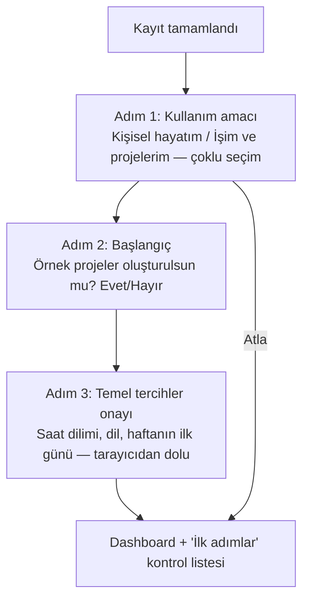

# Onboarding ve Kişiselleştirme

> Durum: v0.5 · Son güncelleme: 2026-10-28 · Genel yaklaşım ONAYLI (D-063). **Ekranlar, adımlar, metinler ve başlangıç projelerinin görünümü Figma'daki tasarımlara birebir uyar**; bu belge ile Figma çelişirse Figma geçerlidir, davranış/iş kuralı farkı varsa sorulur. Bağlamsal ipucu tetikleyicileri (§5) P2 (D-061).
> İlgili: [USER_PERSONAS.md](USER_PERSONAS.md) · BR-PREF-001..003 · BR-DASH-001

## 1. Hedefler
1. Kullanıcı kayıttan sonra **60 saniye içinde** ilk görevini eklemiş olmalı.
2. Kullanıcı hesap türü seçmeye **zorlanmaz** (D-002, D-024).
3. Onboarding yalnızca **başlangıç düzenini** etkiler; sonradan her şey değiştirilebilir.
4. Yoğun kullanıcı onboarding'i tek tıkla atlayabilir.

## 2. Akış

> **Uygulama durumu (Faz 3, D-074):** 3 adımlı akış, atlama kuralı, örnek projeler ve amaca göre dashboard düzeni uygulandı. Ekran `/onboarding` (D-065: Figma'da yok; giriş ekranlarının düzeni ve Figma bileşenleri). Yeniden başlatma: Ayarlar · Profil → "Başlangıç rehberi". "İlk adımlar" listesi (§4) Faz 4'te. Örnek projeler Faz 5'e kadar görünmez; rehber bunu kullanıcıya söyler.

- Toplam en fazla 3 adım; her adımda "Atla".
- Yanıtlar `user_preferences.onboarding` içinde saklanır; analitik dışında hiçbir yetki/özelliği etkilemez.
- Onboarding yarıda bırakılırsa bir sonraki girişte bir kez daha önerilir; ikinci kez atlanırsa bir daha gösterilmez (Ayarlar'dan yeniden başlatılabilir).

## 3. Amaca göre başlangıç düzeni

| Seçim | Örnek projeler (isteğe bağlı) | Dashboard widget sırası | Varsayılan görünüm | İpuçları |
|---|---|---|---|---|
| Yalnızca Kişisel | "Ev", "Sağlık", "Kişisel gelişim" | Bugün, Geciken, Yaklaşan, Hedefler | Liste | Tekrarlayan görev, hatırlatıcı, hedef |
| Yalnızca İş | "İş" (+ açıklama: "Her müşteri/iş için ayrı proje oluşturabilirsin") | Bugün, Geciken, Öncelikli, Projeler, Yaklaşan | Liste (board önerisi ipucu olarak) | Board, etiket filtreleri, notları projeye bağlama |
| İkisi birden | "Ev", "İş" | Bugün, Geciken, Yaklaşan, Projeler, Hedefler | Liste | Etiketlerle bağlam ayırma (`#iş`, `#ev`) |
| Atlandı | Yok (yalnızca Inbox) | Varsayılan (Bugün, Geciken, Yaklaşan, Öncelikli, Projeler, Hedefler) | Liste | Kısayol rehberi (`?`) |

Örnek projelerde **örnek görev oluşturulmaz** (ÖNERİ) — kullanıcının kendi verisini kirletmemek için. Bunun yerine boş durum ekranları rehberlik eder.

## 4. "İlk adımlar" kontrol listesi

> **Uygulama durumu (Faz 4, D-080):** 1, 2, "Bir göreve tarih ekle" ve 6. maddeler uygulandı; hatırlatıcı, tekrar, pano ve hedef maddeleri ilgili fazlarda eklenir.
Dashboard'da katlanabilir kart; tamamlanan maddeler otomatik işaretlenir; tümü bitince veya kapatılınca kaybolur.
1. İlk görevini ekle
2. Bir görevi projeye taşı
3. Bir göreve tarih ve hatırlatıcı ekle
4. Tekrarlayan bir görev oluştur
5. (İş seçildiyse) Board görünümünü dene · (Kişisel seçildiyse) Bir hedef belirle
6. Klavye kısayollarını keşfet (`?`)

## 5. Aşamalı açıklama (progressive disclosure) — yoğun kullanıcı desteği (SONRA — P2, D-061)

> Aşağıdaki tetikleyiciler kullanım izleme mantığı gerektirdiği için MVP'den çıkarıldı (D-061). MVP'de gelişmiş özellikler (toplu işlem çubuğu, kayıtlı görünümler, kısayol rehberi `?`) her zaman erişilebilirdir; yalnızca otomatik öneriler yoktur.
Gelişmiş özellikler herkese açıktır ama **ihtiyaç anında** önerilir:

| Tetikleyici | Öneri |
|---|---|
| Aynı filtre kombinasyonu 3 kez kurulduysa | "Bu görünümü kaydet" |
| Bir listede 2+ görev seçildiğinde | Toplu işlem çubuğu |
| Kullanıcı fareyle aynı işlemi 5 kez yaptıysa | İlgili klavye kısayolu ipucu (oturum başına en fazla 1) |
| Açık görev sayısı > 200 | "Sıkı yoğunluk" önerisi |
| Inbox > 20 görev | "Inbox'ı düzenle" ipucu |

İpuçları kapatılabilir ve bir kez kapatılanlar tekrar gösterilmez (`onboarding.dismissedTips`).

## 6. Kişiselleştirme ayarları

| Ayar | Seçenekler | Varsayılan | Etki | Kural |
|---|---|---|---|---|
| Tema | Açık / Koyu / Sistem | Sistem | Sunum | BR-PREF-003 |
| Yoğunluk | Rahat / Sıkı | Rahat | Satır yüksekliği, boşluk | |
| Dil | Türkçe / English (D-038) | Tarayıcı | Metinler, varsayılan biçimler | BR-PREF-001 |
| Saat dilimi | IANA listesi (arama ile) | Tarayıcı | "Bugün", gösterim | BR-DATE-003/005 |
| Tarih biçimi | `GG.AA.YYYY`, `YYYY-AA-GG`, `AA/GG/YYYY` | Dile göre | Sunum | |
| Saat biçimi | 24 / 12 | Dile göre | Sunum | |
| Haftanın ilk günü | Pazartesi / Pazar / Cumartesi | Dile göre | Takvim, "bu hafta" | |
| Açılış sayfası | Dashboard / Inbox / My Tasks | Dashboard | Navigasyon | |
| Varsayılan görev görünümü | Liste / Board / Takvim | Liste | Yeni açılan projeler | |
| Tüm gün hatırlatıcı saati | Saat | 09:00 | Göreli hatırlatıcı hesabı | BR-REM-001 |
| Dashboard düzeni | Widget göster/gizle, sırala | Onboarding'e göre | | BR-DASH-001 |
| Bildirimler | Tür bazında aç/kapat (MVP'de yalnızca uygulama içi, D-037) | Hatırlatıcılar açık | | BR-NOTIF-004 |
| Kenar çubuğu | Proje sıralaması, sabitlenen görünümler | — | | |

### 6.1. Tutarlılık sınırları
Kişiselleştirme **asla** şunları değiştirmez: iş kuralları, yetkiler, veri modeli, eylemlerin anlamı (ör. "sil" her zaman çöpe gönderir), klavye kısayollarının temel seti (MVP).

### 6.2. Tercihlerin uygulanma yeri
- Sunucu: saat dilimi (bugün hesabı), dil (güvenlik e-postaları ve hata mesajları), bildirim tercihleri.
- İstemci: tema, yoğunluk, tarih/saat biçimi, varsayılan görünüm.
- Tema, ilk boyamada yanıp sönmeyi önlemek için sunucuda çerez/ön yükleme ile uygulanır.

## 7. MVP / sonra

| Özellik | MVP | Sonra |
|---|---|---|
| 3 adımlı onboarding, başlangıç projeleri | ✔ | |
| İlk adımlar kontrol listesi | ✔ (P1) | |
| Bağlamsal ipuçları (tetikleyiciler) | — | P2 (D-061) |
| Ayarlar tablosundaki tüm tercihler | ✔ | |
| Özelleştirilebilir kısayollar | | P2 |
| Proje bazlı tema/simge özelleştirme | Renk + simge ✔ | Kapak görselleri ✖ |
| Şablonlar (proje/görev şablonu) | | P2 |
| Paylaşılan çalışma alanı onboarding'i (davetle gelen kullanıcı) | | Faz 10 |
