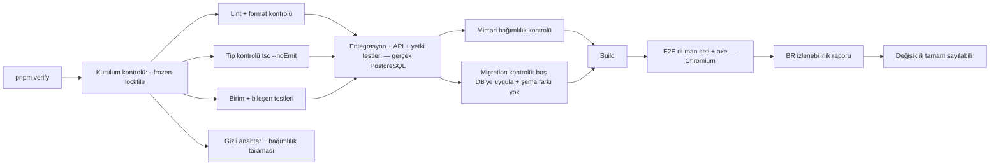

# Test Stratejisi ve Kabul Kriterleri

> Durum: v0.4 · Son güncelleme: 2026-10-28 · Uygulama durumu: Test altyapısı kuruldu (Faz 2); birim, entegrasyon, tarayıcı testleri ve yetki matrisi kontrolü `pnpm verify` içinde çalışıyor.
> Araçlar: Vitest ve Playwright (D-044). Testing Library, Testcontainers (Docker, D-056), axe-core, fast-check onaylı ama yalnızca ihtiyaç duyulduğunda eklenir (D-058). Kapsam hedefleri D-060 ile onaylı.

## 1. İlkeler
1. **İş kuralı = test.** Her `BR-*` kuralının en az bir testi vardır; test adı kural kimliğini içerir: `it('BR-TASK-004: tamamlamada completedAt dolar', ...)`.
2. **Yetki testleri isteğe bağlı değildir.** Her uç noktanın çapraz kullanıcı testi `pnpm verify` içinde zorunludur.
3. **Gerçek veritabanı.** Repository ve use case testleri sahte (mock) veritabanıyla değil, gerçek PostgreSQL ile çalışır (Docker üzerinde Testcontainers, D-056) — CHECK/UNIQUE/FK kısıtları da test edilir.
4. **Zaman kontrol edilir.** Domain ve use case'ler `Clock` portu kullanır; testler sabit/ilerletilebilir saat kullanır. `Date.now()` doğrudan çağrılmaz.
5. **Bağımsız testler.** Her test kendi verisini fabrikalarla oluşturur; sıra bağımlılığı yok.
6. **Mutlu yol + hata yolları.** Geçersiz girdi, yetkisiz erişim, çakışma ve uç senaryolar başarılı senaryo kadar önemlidir.

## 2. Test piramidi

| Seviye | Kapsam | Araç | Hız | Ne zaman |
|---|---|---|---|---|
| Birim | Domain (varlıklar, değer nesneleri, saf servisler: tekrar, tarih, ilerleme, izin matrisi) | Vitest | ms | Geliştirme (watch), `pnpm verify` |
| Bileşen | UI bileşenleri (davranış, erişilebilirlik özellikleri) | Vitest + Testing Library + jsdom | ms | Geliştirme, `pnpm verify` |
| Entegrasyon | Use case + repository + gerçek DB; zamanlanmış bakım işleri | Vitest + gerçek PostgreSQL | sn | `pnpm verify`; geliştirmede değişen modül |
| API | Route handler'lar: doğrulama, hata eşleme, yetki, idempotency | Vitest + uygulama sunucusuna HTTP istekleri + gerçek PostgreSQL | sn | `pnpm verify` |
| Yetkilendirme | Her uç nokta × (sahip, başka kullanıcı, oturumsuz) | Tablo tabanlı API testleri | sn | `pnpm verify` — **kapı** |
| Uçtan uca (E2E) | Kritik kullanıcı akışları tarayıcıda | Playwright | dk | `pnpm verify`: duman seti (Chromium); faz kapanışı: tam set (3 motor) |
| Erişilebilirlik | Ana ekranlarda axe taraması | Playwright + axe-core | dk | `pnpm verify` (duman), faz kapanışı (tam) |
| Regresyon | Düzeltilen her hata için test | İlgili seviye | — | Hata düzeltmesinde zorunlu |
| Görsel regresyon | Ekran görüntüsü karşılaştırma | Playwright | dk | SONRA (Faz 8 değerlendirme) |
| Performans | 10.000 görevli seed ile API süreleri | k6 veya Vitest bench | dk | Faz 8, sürüm öncesi |

## 3. Kapsam hedefleri (D-060)
| Katman | Satır/dal kapsamı |
|---|---|
| Domain | ≥ %90 |
| Application | ≥ %80 |
| HTTP adaptörleri | Kapsam yüzdesi yerine: her uç nokta için §2.7 (API_CONTRACTS) listesi |
| UI | Kritik bileşenler (TaskRow, DatePicker, QuickAdd, NoteEditor) davranış testleri |

Kapsam yüzdesi tek başına kalite ölçütü değildir. `pnpm verify` içindeki **kural izlenebilirlik raporu** (`scripts/br-coverage.mjs`) şunları denetler: (1) kodda `// BR-XXX-000` yorumuyla uygulanan her kuralın en az bir testi vardır; (2) kod ve testlerde geçen her kural kimliği BUSINESS_RULES.md'de tanımlıdır. İkisinden biri sağlanmazsa doğrulama başarısız olur. Henüz uygulanmamış (gelecek fazlara ait) kurallar hata sayılmaz; rapor yalnızca sayılarını gösterir. Faz kapanışında, o fazın kapsamındaki kuralların uygulanmış ve testli olduğu ayrıca kontrol edilir.

## 4. Modül bazında temel test senaryoları

### 4.1. identity
- Kayıt: geçerli → kullanıcı + kişisel alan + Inbox + tercihler (tek işlem); çakışan e-posta → genel yanıt; kısa şifre → 400.
- Giriş: doğru/yanlış; hız sınırı; oturum çerezi öznitelikleri.
- Şifre sıfırlama: token tek kullanımlık, süre aşımı, tüm oturumların düşmesi.
- Çıkış: oturum sunucuda geçersiz.
- Hesap silme: talep, iptal, 14 gün sonrası temizlik (tüm tablolarda sayım = 0), iş idempotentliği.
- Güvenlik e-postaları (D-055): doğrulama, şifre sıfırlama ve "Şifren değişti" e-postaları Mailpit'te görünür; bunların dışında e-posta gönderilmez (D-062).
- Şifreyle yeniden doğrulama: yanlış şifreyle dışa aktarma ve hesap silme reddedilir (D-055).
- Dışa aktarma (D-059): JSON çalışma alanı içeriğini, profili ve tercihleri içerir; şifre hash'i, oturum, token, idempotency, denetim kaydı ve IP/user-agent alanlarının **hiçbiri** dosyada yoktur (şema düzeyinde test).
- Bakım işleri (D-053): sahte saat ile 30 ve 14 günlük sürelerin dolması; uygulama açılışında çalışma; aynı anda iki çalışmada tek etki (veritabanı kilidi).

### 4.2. workspaces / yetki
- İzin matrisi tablosu ↔ `ROLE_PERMISSIONS` eşleşmesi.
- `WorkspaceScope` olmadan repository çağrısı derlenmez (tip testi).
- Çapraz alan bağlantısı (görev ↔ başka alanın projesi) → 404 ve DB FK hatası (doğrudan SQL denemesiyle).

### 4.3. tasks
- BR-TASK-001..010, BR-SUB-001..005, BR-DATE-001..006 için birim testleri.
- Tamamlama: alt görev seçenekleri, tekrar örneği üretimi, hatırlatıcı iptali — tek işlem (bir adım başarısızsa hiçbiri uygulanmaz).
- Sıralama: fractional index uçları (başa, sona, iki komşu arası, çok sayıda ardışık ekleme).
- Toplu işlem: 200 sınırı, atomiklik, karışık yetki.
- Idempotency: aynı anahtar/aynı gövde, aynı anahtar/farklı gövde, 24 saat sonrası.

### 4.4. recurrence (domain servisi)
- Her kalıp (günlük/haftalık/aylık/yıllık, aralık, bitiş türleri) için tablo tabanlı testler.
- Ay sonu (31 → 30/28/29), 29 Şubat.
- DST'li saat dilimlerinde saatli tekrarlar.
- `fixed_schedule` geçmiş tarih atlama; `after_completion`.
- **Özellik tabanlı test** (fast-check): üretilen sonraki tarih her zaman bir öncekinden büyük; kuralın gününe uyar.

### 4.5. reminders / notifications
- Göreli hesap (saatli ve tüm gün), tarih değişince yeniden hesap, tarih kaldırılınca silme.
- Bildirime dönüştürme: paralel iki istek → tek bildirim; gecikmeli/atlanmış davranışı (sahte saat); uygulama kapalıyken zamanı geçen hatırlatıcılar (E18).
- Yalnızca uygulama içi bildirim oluşur; e-posta teslim kaydı oluşmaz (D-037).
- Günlük özet MVP'de yok (D-054); test gerekmez.

### 4.6. projects / lifecycle
- Arşiv: görevlerin görünmezliği, hatırlatıcı iptali/yeniden etkinleşmesi, arşivli projeye ekleme reddi.
- Silme grubu, geri yükleme (proje + görevler), projesi yok olan görevin Inbox'a dönüşü.
- Çöp temizliği: süre dolanlar silinir, dolmayanlar kalır; FK `RESTRICT` sayesinde yarım silme olmaz.
- Inbox korumaları.

### 4.7. notes
- Boş not oluşturulmaz; çatışma kopyası; bağlantıların aynı alan kuralı; Markdown sanitizasyonu (XSS yükleri: `<script>`, ``, `javascript:` bağlantısı).

### 4.8. goals
- Otomatik ilerleme: doğrudan + proje üzerinden aynı görev bir kez sayılır; çöpteki kayıt hariç; bağlantı yokken `null`.
- Manuel ↔ otomatik geçişte manuel değer korunur.

### 4.9. search
- Türkçe karakter duyarsızlığı (`ışık` ↔ `isik`, `İstanbul` ↔ `istanbul`).
- Çöpteki kayıtlar asla dönmez; başka kullanıcının kayıtları asla dönmez.
- 2 karakter alt sınırı, zaman aşımı.

### 4.10. preferences / dashboard
- Varsayılanların dil ve saat dilimine göre oluşması.
- Bozuk JSONB → varsayılana düşme.
- "Bugün" hesabının sunucu tarafında kullanıcının saat dilimiyle yapılması (gece yarısı sınırı testleri: UTC+3 ve UTC-8).

## 5. Yetkilendirme test matrisi (zorunlu kapı)

Her uç nokta için tablo tabanlı test üretilir:

| Aktör | Beklenen |
|---|---|
| Oturumsuz | 401 |
| Kaynağın sahibi | 2xx |
| Başka kullanıcı (kendi alanında aynı türde kaynak var) | 404, veri değişmez |
| Başka kullanıcı, kendi `workspaceId`'si + hedef kaynağın `id`'si | 404 |
| (Faz 10) Her rol | ROLES_AND_PERMISSIONS §6.2 tablosuna göre |

Yeni bir uç nokta bu matrise eklenmeden iş tamamlanmış sayılmaz. Matris `tests/authorization-matrix.json` dosyasındadır; `pnpm verify` içindeki "Yetki matrisi" adımı (`scripts/route-matrix.mjs`) `src/app/api/v1` rotalarını matrisle karşılaştırır, `tests/e2e/authorization.spec.ts` oturumsuz satırları sınar. `/me/*` uç noktaları istekte kullanıcı kimliği almaz; "başka kullanıcı" satırı yerine aktörün yalnızca kendi kaydını değiştirdiği entegrasyon testiyle kanıtlanır (BR-PREF-002).

## 6. Kabul kriterleri (Given/When/Then) — kritik gereksinimler

Kural bazında kabul kriterleri BUSINESS_RULES.md içindedir. Aşağıdakiler uçtan uca (E2E) kabul senaryolarıdır.

**AC-01 Kayıt ve ilk görev**
- Given kayıtlı olmayan bir ziyaretçi, When geçerli bilgilerle kayıt olur ve onboarding'i atlar, Then dashboard açılır ve Inbox sayacı 0'dır.
- When `Q` ile "Fatura öde" görevini ekler, Then görev Inbox'ta görünür ve sayaç 1 olur.

**AC-02 Inbox triage**
- Given Inbox'ta 3 görev ve "Ev" projesi, When 2 görev seçilip "Ev"e taşınır, Then Inbox sayacı 1, "Ev" projesinde 2 görev vardır ve görevlerin tarih/etiketleri değişmemiştir.

**AC-03 Tamamlama ve geri alma**
- Given bugün tarihli bir görev, When tamamlanır, Then Bugün widget'ından kalkar ve "Geri al" toast'u görünür; When "Geri al"a tıklanır, Then görev açık olarak geri gelir.

**AC-04 Tekrarlayan görev**
- Given "her pazartesi" tekrarlayan ve bu pazartesi tarihli görev, When tamamlanır, Then bir sonraki pazartesi tarihli yeni bir açık görev oluşur ve eskisi tamamlanmış görünür (D-033, planlanan tarihe göre). Given "tamamlandıktan 3 gün sonra" modunda görev, When 15 Ekim'de tamamlanır, Then yeni örnek 18 Ekim tarihli olur.

**AC-05 Hatırlatıcı**
- Given 1 dk sonrası için hatırlatıcı, When süre dolar, Then bildirim merkezinde tek bir bildirim görünür ve tıklanınca görev açılır.

**AC-06 Proje silme ve geri yükleme** (D-031)
- Given 5 görevli bir proje, When silinir, Then proje ve görevler listelerden kalkar ve çöpte tek grup olarak görünür; When geri yüklenir, Then proje ve 5 görev eski yerlerinde görünür.

**AC-07 Yetkisiz erişim**
- Given A ve B kullanıcıları, When A, B'nin görev URL'sini açar, Then "bulunamadı" ekranı görür ve hiçbir B verisi yanıtta yer almaz.

**AC-08 Not otomatik kaydetme**
- Given açık bir not, When kullanıcı yazar ve 2 sn bekler, Then "Kaydedildi" görünür; When sayfa yenilenir, Then içerik korunmuştur.
- Given ağ kesik, When kullanıcı yazar, Then "Kaydedilemedi, yerel olarak saklandı" görünür; When ağ geri gelir, Then içerik kaydedilir.

**AC-09 Saat dilimi**
- Given İstanbul saat dilimli kullanıcı ve 15 Ekim tarihli tüm gün görev, When tarayıcı saati 15 Ekim 23:30 (İstanbul), Then görev "Bugün"dedir; When 16 Ekim 00:01, Then "Geciken"dedir.

**AC-10 Arama**
- Given "Işık faturası" başlıklı görev, When "isik" aranır, Then görev sonuçlarda görünür; Given aynı görev çöpte, Then görünmez.

**AC-11 Erişilebilirlik**
- Given dashboard, Inbox, proje listesi, görev detayı, takvim, ayarlar, When axe taraması çalışır, Then kritik veya ciddi ihlal yoktur; When yalnızca klavye kullanılır, Then görev eklenir, tamamlanır, taşınır ve silinebilir.

## 7. Test verisi
- Fabrikalar: DATA_MODEL §8.
- E2E: her test yeni kullanıcıyla başlar (API üzerinden hızlı kayıt yardımcı fonksiyonu); paylaşılan hesap yok.
- Test e-postaları: yerel e-posta yakalayıcı (Mailpit, Docker — D-056) veya bellek içi test adaptörü; E2E doğrulama/sıfırlama bağlantılarını buradan okur. Ücretli e-posta servisi kullanılmaz (D-037).
- Sahte saat: zamanlanmış iş ve use case testlerinde `FakeClock`; E2E'de saat dilimi Playwright `timezoneId` ile.

## 8. Doğrulama hattı (yerel — D-057)

Ücretli servis kullanılmaz (D-045). Tüm kontroller yerelde tek komutla çalışır: `pnpm verify`. Şimdilik CI yoktur; GitHub Actions daha sonra değerlendirilebilir (D-057). Değerlendirilirse aynı `pnpm verify` komutu orada çalıştırılır.

| Ne | Geliştirme sırasında | Pre-commit (git hook) | `pnpm verify` (her iş sonunda) | Faz kapanışında |
|---|---|---|---|---|
| Lint, format | Editör | ✔ (değişen dosyalar) | ✔ | ✔ |
| Tip kontrolü | Editör | | ✔ | ✔ |
| Birim/bileşen | Watch | | ✔ | ✔ |
| Entegrasyon/API/yetki | Değişen modül | | ✔ | ✔ |
| E2E duman (Chromium) | İsteğe bağlı | | ✔ | ✔ |
| E2E tam (Chromium + Firefox + WebKit) | | | | ✔ |
| Erişilebilirlik tam tarama | | | | ✔ |
| Bağımlılık taraması | | | ✔ | ✔ |
| Performans (10.000 görev) | | | | Faz 4 ve Faz 8 |

**Gerçek PostgreSQL ile test:** Testcontainers, Docker Desktop üzerinde her test koşusunda geçici bir veritabanı açar (D-056). Böylece gerçek kullanıcı verisi içeren veritabanına asla dokunulmaz.

Başarısız test "flaky" ise devre dışı bırakılmaz; karantinaya alınıp hemen düzeltilir ve faz raporunda belirtilir.

**Tarayıcı testlerinin ortamı (Faz 3):** Playwright, uygulamanın **üretim derlemesini** (`next build` + `next start`) 3100 portunda ve ayrı derleme klasörüyle (`.next-e2e`) başlatır. Geliştirme modunun anlık yeniden yüklemesi (HMR), OneDrive klasöründe aralıklı olarak sayfaların sürekli yeniden yüklenmesine ve testlerin kararsızlaşmasına yol açtığı için üretim derlemesi kullanılır (D-075). Geliştirmeye özel `/dev/ui` sayfası üretimde 404 döner; bileşenlerin erişilebilirliği gerçek sayfalardaki axe taramalarıyla denetlenir. Her çalıştırmada sıfırdan kurulan `aysly_e2e` veritabanını kullanır, böylece geliştirme veritabanına dokunmaz. E-postalar Mailpit API'sinden okunur. Testlerde kimlik doğrulama hız sınırı kapalıdır (`AUTH_RATE_LIMIT_ENABLED=false`); sınırın kendisi entegrasyon testiyle kanıtlanır.

**Performans (Faz 4):** `tests/integration/performance.test.ts` 1.000 üst düzey + 300 alt görevle Inbox listesi, Görevlerim ve Bugün bölümlerinin use case + veritabanı süresini ölçer (5 ısınma, 50 ölçüm); p95 < 300 ms beklenir. Ölçülen: ≈ 90 ms. 10.000 görevli API ölçümü Faz 8'de.

## 9. Tamamlanma tanımı (test açısından)
Bir değişiklik şu koşullarla tamamdır: ilgili BR testleri yazıldı/güncellendi; yetki matrisi güncel; `pnpm verify` tamamen yeşil (gerçekten çalıştırıldı); düzeltilen hata için regresyon testi var; yeni E2E akışı gerekiyorsa eklendi.
