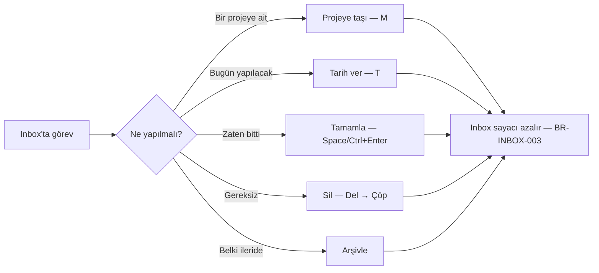
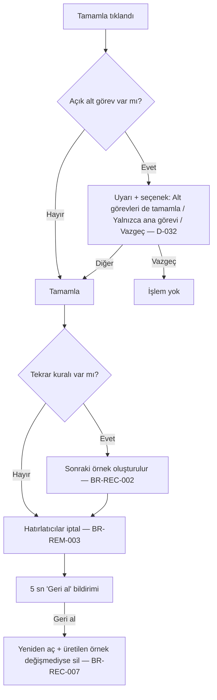
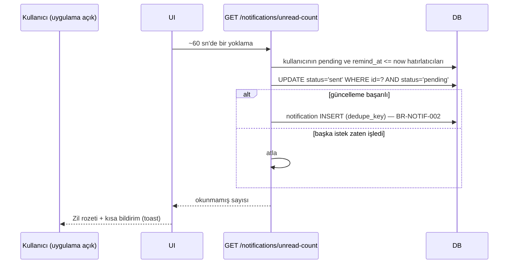

# Ekranlar, Navigasyon ve Kullanıcı Akışları

> Durum: v0.4 · Son güncelleme: 2026-10-15
> Ekran yapıları, navigasyon ve görsel düzen için Figma tek kaynaktır (D-063). Bu belgedeki ekran tarifleri ve ASCII çizimler Figma öncesi taslaktır; Figma ile çelişirse Figma geçerlidir. Akışlardaki iş kuralı davranışları (BR-*) ise BUSINESS_RULES'a bağlıdır.
> İlgili: [UI_UX_DESIGN_SYSTEM.md](UI_UX_DESIGN_SYSTEM.md) (görsel kurallar, wireframe'ler) · [BUSINESS_RULES.md](BUSINESS_RULES.md) · [ERROR_HANDLING_AND_EDGE_CASES.md](ERROR_HANDLING_AND_EDGE_CASES.md)

## 1. Bilgi mimarisi ve navigasyon

```mermaid
flowchart TD
  ROOT[Aysly] --> PUB[Herkese açık]
  ROOT --> APP[Uygulama — oturum gerekli]
  PUB --> SIGNIN[Giriş /sign-in]
  PUB --> SIGNUP[Kayıt /sign-up]
  PUB --> FORGOT[Şifremi unuttum /forgot-password]
  PUB --> RESET[Şifre sıfırlama /reset-password]
  PUB --> VERIFY[E-posta doğrulama /verify-email]
  APP --> ONB[Onboarding /welcome]
  APP --> DASH[Dashboard /]
  APP --> INBOX[Inbox /inbox]
  APP --> MY[My Tasks /my-tasks]
  APP --> CAL[Takvim /calendar]
  APP --> PRJ[Projeler /projects]
  PRJ --> PRJD[Proje detayı /projects/:id?view=list|board|calendar]
  APP --> GOALS[Hedefler /goals] --> GOALD[/goals/:id]
  APP --> NOTES[Notlar /notes] --> NOTED[/notes/:id]
  APP --> VIEWS[Kayıtlı görünüm /views/:id]
  APP --> NOTIF[Bildirimler /notifications]
  APP --> ARCH[Arşiv /archive]
  APP --> TRASH[Çöp kutusu /trash]
  APP --> SET[Ayarlar /settings/*]
  APP -.-> TASKD[Görev detayı: yan panel ?task=:id veya /tasks/:id]
  APP -.-> SEARCH[Global arama: Ctrl/Cmd+K]
  APP -.-> QADD[Hızlı ekleme: Q]
```

### 1.1. Kenar çubuğu (masaüstü)
```
[Aysly logosu]                [🔔 3]  [avatar]
──────────────────────────────
 + Görev ekle            (Q)
 🔍 Ara               (Ctrl+K)
──────────────────────────────
 ◉ Dashboard
 📥 Inbox                 7
 ✔ My Tasks
 📅 Takvim
 🎯 Hedefler
 📝 Notlar
──────────────────────────────
 PROJELER                 +
  ● Müşteri A — Web       67%
  ● Ev                    20%
  ● B2 İngilizce
──────────────────────────────
 KAYITLI GÖRÜNÜMLER       +
  ★ Bu hafta – yüksek
──────────────────────────────
 Arşiv · Çöp kutusu · Ayarlar
```

### 1.2. Mobil navigasyon
- Alt sekme çubuğu: **Bugün (Dashboard)** · **Inbox** · **(+) Ekle** · **Takvim** · **Menü**.
- "Menü" tam ekran sayfa: My Tasks, Projeler, Hedefler, Notlar, Kayıtlı görünümler, Arşiv, Çöp, Ayarlar.
- Görev detayı mobilde tam ekran sayfa; masaüstünde sağ yan panel (liste görünür kalır).

### 1.3. URL ve durum kuralları
- Her ekran ve açık görev detayı URL ile paylaşılabilir/yer imi yapılabilir (`?task=<id>`).
- Filtreler URL'de saklanır (`?status=todo&due=next7`); geri tuşu filtre değişikliğini geri alır.
- Görünüm değişimi (`?view=board`) filtreleri korur (BR-VIEW-002).

## 2. Ekran envanteri

Her ekran için ortak durumlar: **Yükleniyor** (iskelet/skeleton, 300 ms'den kısa yüklemelerde gösterilmez), **Boş**, **Hata** (yeniden dene), **Çevrimdışı bandı**. Ayrıntılı mesajlar: ERROR_HANDLING_AND_EDGE_CASES.

### 2.1. Giriş ve kayıt
| | |
|---|---|
| Amaç | Hesaba erişim / hesap oluşturma |
| Bileşenler | E-posta, şifre (göster/gizle), ad (kayıt), "Şifremi unuttum", kayıt/giriş bağlantısı, gizlilik ve koşullar bağlantıları (lansman öncesi zorunlu; LEGAL REQ-LGL-01..04, D-049) |
| İşlemler | Kayıt, giriş |
| Veri | `/auth/*` |
| Navigasyon | Başarılı kayıt → `/welcome`; başarılı giriş → `start_page` tercihi (veya yönlendirme öncesi istenen sayfa, yalnızca uygulama içi yollar) |
| Hata | Genel "E-posta veya şifre hatalı" (hangisinin yanlış olduğu söylenmez); 429'da bekleme süresi |
| Mobil/masaüstü | Tek sütunlu, ortalanmış form |
| Kurallar | BR-ACC-001..003, BR-ACC-006 |

### 2.2. Onboarding (`/welcome`)
Ayrıntı: [ONBOARDING_AND_PERSONALIZATION.md](ONBOARDING_AND_PERSONALIZATION.md).

### 2.3. Dashboard (`/`)
| | |
|---|---|
| Amaç | "Bugün neye odaklanmalıyım?" (F2) |
| Bileşenler | Selamlama + tarih, hızlı ekleme, widget'lar (Bugün, Geciken, Yaklaşan, Öncelikli, Projeler, Hedefler), "Düzenle" düğmesi |
| İşlemler | Görev tamamla, bugüne/yarına taşı, görev aç, widget göster/gizle/sırala |
| Veri | `GET /dashboard`, `PATCH /me/preferences` |
| Boş durum | Hiç görev yok → "Gününü planlamaya bir görevle başla" + hızlı ekleme odağı. Bugün boş ama gelecek var → "Bugün için planlanmış iş yok 🎉 Yaklaşanlara göz at" |
| Mobil | Widget'lar tek sütun; "Bugün" ve "Geciken" ilk sırada sabit önerilir |
| Kurallar | BR-DASH-001/002, BR-DATE-003 |

### 2.4. Inbox (`/inbox`)
| | |
|---|---|
| Amaç | Yakalanan görevleri işlemek |
| Bileşenler | Hızlı ekleme (üstte), görev listesi, her satırda "Projeye taşı" kısayolu (`M`), çoklu seçim |
| İşlemler | Taşı, tarih ver, tamamla, sil; toplu işlemler |
| Boş durum | "Inbox boş. Aklına gelen her şeyi buraya yaz, sonra düzenle." |
| Kurallar | BR-INBOX-001..003 |

### 2.5. My Tasks (`/my-tasks`)
| | |
|---|---|
| Amaç | Tüm açık görevler tek listede |
| Bileşenler | Gruplar: Geciken · Bugün · Yarın · Bu hafta · Daha sonra · Tarihsiz; gruplama/sıralama/filtre çubuğu; görünüm değiştirici (liste/board/takvim) |
| Kurallar | BR-INBOX-004, BR-VIEW-002 |

### 2.6. Proje listesi (`/projects`) ve detayı (`/projects/:id`)
| | |
|---|---|
| Amaç | Projeleri yönetmek; bir projenin işlerini görmek |
| Liste bileşenleri | Kart veya satır: ad, renk, durum, ilerleme, açık görev sayısı, son güncelleme; filtre (durum), sıralama |
| Detay bileşenleri | Başlık (ad, durum, ilerleme), açıklama (katlanır), görünüm sekmeleri (Liste/Board/Takvim), filtre çubuğu, bağlı notlar ve hedefler (yan bölüm), "…" menüsü (düzenle, tamamla, arşivle, sil) |
| Boş durum | Proje yok → "İlk projeni oluştur"; projede görev yok → hızlı ekleme |
| Arşivli proje | Salt okunur bant + "Arşivden çıkar" (BR-PROJ-004) |
| Silme | Onay penceresi etkilenecek görev sayısıyla (BR-PROJ-005, D-031) |
| Kurallar | BR-PROJ-001..006 |

### 2.7. Görev detayı (yan panel / sayfa)
| | |
|---|---|
| Bileşenler | Tamamlama kutusu, başlık (satır içi düzenleme), proje seçici, durum, öncelik, tarihler (tarih + saat + saat dilimi gösterimi), tekrar, hatırlatıcılar, etiketler, açıklama (Markdown), alt görevler (ekle/sırala/tamamla), bağlı notlar, bağlı hedefler, etkinlik özeti (oluşturuldu/tamamlandı), "…" menüsü (arşivle, sil, bağlantıyı kopyala) |
| Kaydetme | Alan bazında anında kayıt (blur/seçim); başarısızsa alan eski değere döner + hata bildirimi |
| Çakışma | BR-TASK-010 akışı |
| Silinmiş/arşivli | BR-DEL-007 |
| Klavye | `Esc` kapat, `Ctrl+Enter` tamamla, `↑/↓` listedeki önceki/sonraki görev |

### 2.8. Takvim (`/calendar`)
| | |
|---|---|
| Bileşenler | Görünüm (Ay/Hafta/Gün), tarih gezinme, "Bugün", proje/etiket filtresi, tüm gün şeridi, saat ızgarası, (masaüstü) "Tarihsiz" paneli |
| İşlemler | Göreve tıkla → detay; boş güne tıkla → o tarihli hızlı ekleme; sürükle-bırak: masaüstünde hafta ve ay görünümlerinde; mobilde tarih seçici (D-047) |
| Mobil | Varsayılan gün/liste görünümü; ay görünümünde nokta göstergeleri |
| Kurallar | BR-DATE-001..006, FR-CAL |

### 2.9. Hedefler (`/goals`, `/goals/:id`)
| | |
|---|---|
| Liste | Aktif hedef kartları: başlık, hedef tarihi, ilerleme çubuğu (veya "—"); sekmeler: Aktif / Ulaşılan / Bırakılan |
| Detay | Açıklama, ilerleme modu, bağlı projeler ve görevler (ekle/kaldır), "Ulaşıldı olarak işaretle" |
| Boş | "Bir hedef belirle ve onu görevlerle besle." |
| Kurallar | BR-GOAL-001..004 |

### 2.10. Notlar (`/notes`, `/notes/:id`)
| | |
|---|---|
| Liste | Sabitlenenler üstte; başlık, ilk satır önizleme, etiketler, son düzenleme; arama/filtre |
| Editör | Başlık, gövde, kayıt durumu göstergesi, bağlantılar (görev/proje), etiketler |
| Kurallar | BR-NOTE-001..004 |

### 2.11. Global arama (komut paleti)
| | |
|---|---|
| Bileşenler | Arama girişi, türe göre gruplu sonuçlar, klavye gezinme, son aramalar (yerel), "Arşivi dahil et" düğmesi, hızlı komutlar ("Görev ekle", "Ayarlar") |
| Boş sonuç | FR-SRCH-03 |
| Kurallar | BR-SRCH-001/002 |

### 2.12. Bildirimler
Zil simgesi açılır paneli (son 20) + tam sayfa `/notifications`. Okunmamış vurgusu, "Tümünü okundu say". Tıklama → ilgili kayıt.

### 2.13. Arşiv (`/archive`) ve Çöp kutusu (`/trash`)
- **Arşiv:** Tür sekmeleri; her satırda "Arşivden çıkar". Salt okunur önizleme.
- **Çöp:** Silme gruplarına göre satırlar: "Proje: Müşteri A (+23 görev) · 12 gün sonra kalıcı silinecek" · [Geri yükle] [Kalıcı sil]. Üstte [Çöpü boşalt] (çift onay: tür sayılarını gösteren pencere + yazarak onay gerekmez, ancak düğme kırmızı ve açık metinli).

### 2.14. Ayarlar (`/settings/*`)
| Sekme | İçerik |
|---|---|
| Profil | Ad, e-posta (doğrulama durumu), avatar |
| Görünüm | Tema, yoğunluk, dil |
| Tarih ve saat | Saat dilimi, tarih biçimi, 12/24 saat, haftanın ilk günü, tüm gün hatırlatıcı saati |
| Varsayılanlar | Açılış sayfası, varsayılan görev görünümü |
| Bildirimler | Bildirim türlerini aç/kapat (MVP'de yalnızca uygulama içi, D-037; günlük özet yok, D-054) |
| Güvenlik | Şifre değiştir, aktif oturumlar, son güvenlik olayları |
| Veri ve gizlilik | Çalışma alanını JSON olarak dışa aktar (D-046), hesabı sil (D-036) |
| Çalışma alanı | (Faz 10) Üyeler, roller, davetler |

### 2.15. Çalışma alanı yönetimi (Faz 10 — SONRA)
Alan değiştirici (kenar çubuğu üstü), üye listesi, davet, rol değişikliği, alandan ayrılma. MVP'de gizli.

## 3. Önemli kullanıcı akışları

### 3.1. Kayıt → onboarding → ilk görev
```mermaid
sequenceDiagram
  actor K as Kullanıcı
  participant UI
  participant API
  K->>UI: Kayıt formunu doldurur
  UI->>API: POST /auth/sign-up
  API->>API: Kullanıcı + kişisel alan + Inbox + tercihler (tek işlem)
  API-->>UI: 201 + oturum
  UI->>K: /welcome — "Aysly'yi ne için kullanacaksın?"
  K->>UI: Kişisel + İş seçer, örnek içerik ister
  UI->>API: POST /me/onboarding
  API-->>UI: Başlangıç projeleri oluşturuldu
  UI->>K: Dashboard + "İlk görevini ekle" ipucu
  K->>UI: Q → "Faturayı öde, yarın"
  UI->>API: POST /tasks (Idempotency-Key)
  UI->>K: Görev Inbox'ta; "Bir projeye taşı" ipucu
  Note over UI,K: E-posta doğrulama bandı — temel özellikler doğrulamasız kullanılabilir (D-040)
```

### 3.2. Hızlı ekleme (her ekrandan)
1. Kullanıcı `Q` veya `+` → hızlı ekleme penceresi (bulunulan proje bağlamı önceden seçili; yoksa Inbox).
2. Başlık yazar; isteğe bağlı satırdaki çiplerle tarih, proje, öncelik, etiket seçer.
3. `Enter` → kaydedilir, pencere açık kalır (art arda ekleme); `Esc` kapatır.
4. Ağ hatasında metin pencerede kalır, "Kaydedilemedi — Tekrar dene" gösterilir (veri kaybı yok, D-020).

### 3.3. Inbox'ı boşaltma (triage)

Not: Tarih vermek görevi Inbox'tan **çıkarmaz**; Inbox'tan çıkmak için görev bir projeye taşınır, tamamlanır, silinir veya arşivlenir (D-030).

### 3.4. Görev tamamlama (alt görevler ve tekrar dahil)


### 3.5. Proje silme ve geri yükleme
1. Proje "…" → Sil.
2. Arayüz `GET /delete-preview` → onay penceresi: "Bu proje ve içindeki 23 görev çöp kutusuna taşınacak. 30 gün içinde geri yükleyebilirsin." [Vazgeç] [Çöpe taşı].
3. `DELETE /projects/{id}` → yanıt `batchId`; toast: "Proje çöp kutusuna taşındı · Geri al".
4. "Geri al" veya Çöp kutusundan "Geri yükle" → `POST /trash/restore { batchId }` → proje ve görevler aynı yerlerine döner.
(D-031.)

### 3.6. Tekrarlayan görev kurma
1. Görev detayında "Tekrarla" → hazır seçenekler (Her gün, Her hafta içi, Her hafta [gün], Her ay [gün], Her yıl, Özel…).
2. Özel: sıklık + aralık + günler + bitiş.
3. Mod seçimi: "Planlanan tarihe göre" / "Tamamlandıktan sonra" (D-033). Sonraki görev, mevcut görev tamamlandığında oluşturulur.
4. Tarih yoksa arayüz önce tarih ister (BR-REC-001).
5. Özet metin gösterilir: "Her ayın 1'inde, 10:00 (İstanbul)".

### 3.7. Hatırlatıcı alma (yalnızca uygulama içi, D-037; uygulama açıkken işlenir, D-053)

Uygulama kapalıyken zamanı gelen hatırlatıcılar, uygulama açıldığında "gecikmeli" etiketiyle görünür (24 saatten eskiler atlanır, BR-REM-005). E-posta ile hatırlatma SONRA (D-037).

### 3.8. Not düzenleme ve otomatik kaydetme
1. Kullanıcı yazar → 1 sn bekleme → `PATCH /notes/{id}` (`version`).
2. Göstergeler: "Kaydediliyor…" → "Kaydedildi".
3. Ağ hatası → "Kaydedilemedi, yerel olarak saklandı" + otomatik yeniden deneme (artan aralıklarla); taslak tarayıcıda.
4. `409` → BR-NOTE-002 (çatışma kopyası).
5. Sayfadan çıkışta kaydedilmemiş değişiklik varsa tarayıcı uyarısı.

### 3.9. Şifre sıfırlama
Şifremi unuttum → e-posta gir → "E-posta kayıtlıysa bağlantı gönderdik" → bağlantı → yeni şifre (BR-ACC-002) → "Şifren değişti, tüm cihazlarda oturum kapatıldı" → giriş sayfası. Yerel ortamda sıfırlama e-postası e-posta yakalayıcıda görünür (D-045).

### 3.10. Hesap silme (D-036)
Ayarlar → Veri ve gizlilik → "Hesabımı sil" → açıklama (ne silinir, bekleme süresi, önce dışa aktarma önerisi) → şifre girişi → onay → oturum kapanır (bilgilendirme e-postası MVP'de yok, D-062). 14 gün içinde giriş → "Hesabın silinmek üzere. Silmeyi iptal et?" 14 gün dolunca, uygulama bir sonraki çalıştığında hesap ve veriler kalıcı silinir (D-053).

### 3.11. Arama
`Ctrl+K` → yaz (≥ 2 karakter, 200 ms gecikmeli istek) → gruplu sonuçlar → `Enter` ile aç. Sonuç yoksa: "‘xyz’ için sonuç yok · Arşivi de ara · ‘xyz’ başlıklı görev oluştur".

### 3.12. Eşzamanlı düzenleme çatışması
Sekme A ve B aynı görevi açar → A başlığı değiştirir → B açıklamayı değiştirir: farklı alanlar, istemci 409 sonrası otomatik birleştirir ve kaydeder. B de başlığı değiştirirse: "Bu görev başka bir yerde değiştirildi. Senin değişikliğin: ‘…’ · Güncel: ‘…’ [Benimkini kullan] [Güncel olanı tut]".
